# Access control vulnerabilities
## 1. Unprotected admin functionality
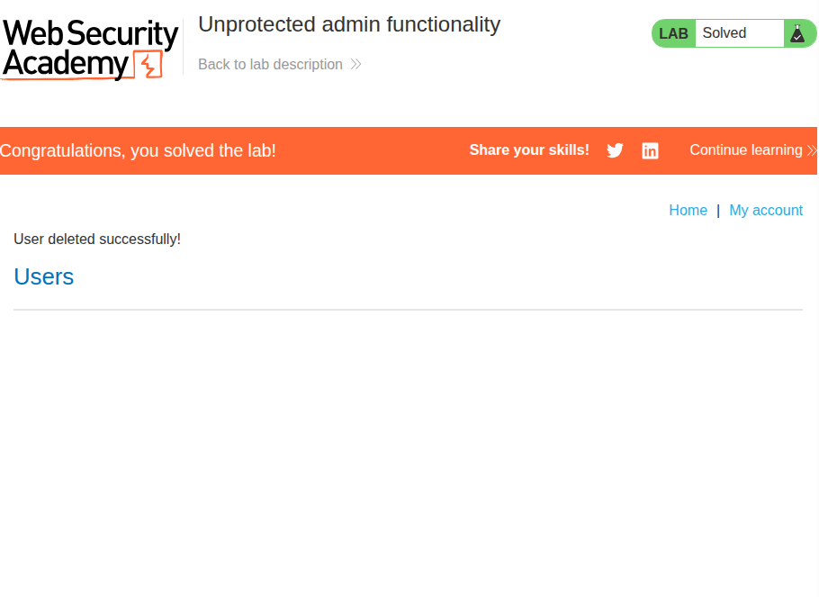

### Description
Simple lab that involves exploiting an unprotected admin panel to delete the user `carlos`.

### Solution
First, I obviously had to find the URI that leads to the admin panel. There's a variety of ways to do this, but `robots.txt` could be a good start as it publicly declares certain endpoints.

Accessing `/robots.txt` on the lab server revealed that the admin panel could be found at `/administrator-panel`.

Upon visiting the page (visible in the picture above), it presented a "delete" option for all users, so I just deleted `carlos` and completed the lab. 

---

## 2. Unprotected admin functionality with unpredictable URL
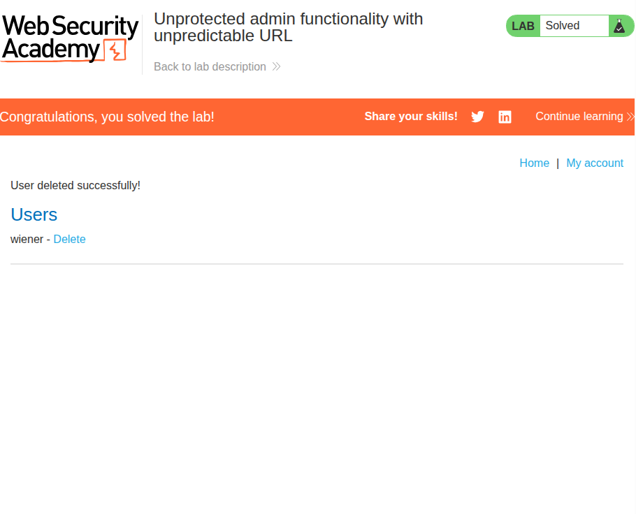

### Description
Simple lab that involves exploiting an unprotected admin panel to delete the user `carlos`.

This time, the URL that leads to the admin panel is obfuscated using a hash value.

### Solution
Other places that may expose an admin URL could be a client-side script that changes the front-end depending on the user's authorization status. So, I looked at BurpSuite's Proxy to see if I was receiving a "script" type response, but there was none.

After a minute or so of thinking, I finally realized that it could also have just been embedded in the HTML. As it turns out, it was!
> ```js
> <script>
>     var isAdmin = false;
>     if (isAdmin) {
>        var topLinksTag = document.getElementsByClassName("top-links")[0];
>        var adminPanelTag = document.createElement('a');
>        adminPanelTag.setAttribute('href', '/admin-k4bxpo');
>        adminPanelTag.innerText = 'Admin panel';
>        topLinksTag.append(adminPanelTag);
>        var pTag = document.createElement('p');
>        pTag.innerText = '|';
>        topLinksTag.appendChild(pTag);
>     }
> </script>
> ```

The above script seems to add clickable links for administrators that they could use to quickly jump to the admin page. We can see that the URI that leads to the admin page is `/admin-k4bxpo`.

Upon visiting this endpoint, the administrator functionalities are completely unprotected and I was able to just straight up delete `carlos` and finish the lab.

---

## 3. User role controlled by request parameter
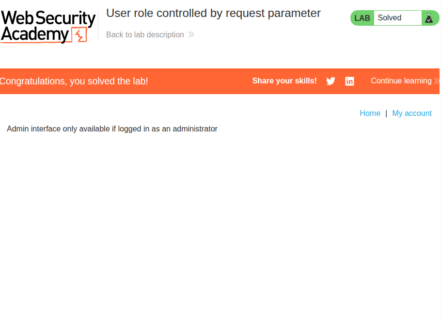

### Description
Simple lab that involves exploiting an unprotected admin panel to delete the user `carlos`.

This time, the path is revealed to be `/admin`, but the server checks for a **request parameter** to check a user's authorization level.

### Solution
The first thought I had was that it might check URL parameters, but I'd have to guess them since only the `id` parameter was visible upon logging into the lab-provided account.

Then, I inspected the GET requests I made to the `/admin` endpoint. It turns out that the requests had the following cookies:

> `Cookie: Admin=false; session=zUKIHLnZHWxGnxFwnhDAGsryZmrqG8zj`

I quickly changed the `Admin` cookie to `Admin=true`, and the server returned the admin page to me. Through BurpSuite, I inspected the HTML and found the following:

> ```html
> <div>
>     <span>carlos - </span>
>     <a href="/admin/delete?username=carlos">Delete</a>
> </div>
> ```

The next step was simple, I simply replaced the request endpoint to the one that deletes `carlos` and finished the lab.

This lab was more or less purely through BurpSuite, so the image above still shows the admin panel for an unauthorized user.

---

## 4. User role can be modified in user profile
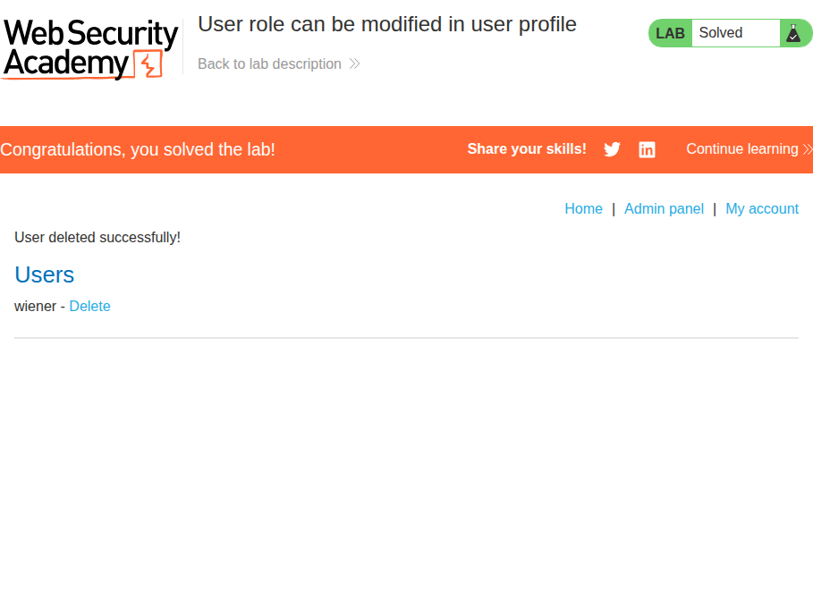

### Description
Simple lab that involves exploiting an unprotected admin panel to delete the user `carlos`.

This time, the path is revealed to be `/admin`, but the server checks the **backend** to ensure that the user has `roleid=2`.

### Solution
The first thing that stood out to me was an email update function in the profile page. I tried changing the email to `test@test.com` and checked the request. It had the following JSON payload:

> ```json
> {
>     "email":"test@test.com"
> }
> ```

So, since I needed `roleid=2`, I simply modified this payload to:

> ```json
> {
>     "email":"test@test.com",
>     "roleid":2
> }
> ```

And to my surprise, it worked! The server returned with the following response:

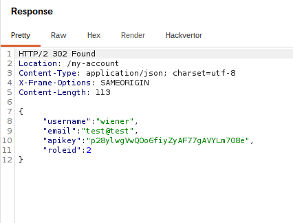

The above indicated that my change had been successful, so I went and checked the `/admin` endpoint, which revealed to me the list of users I could delete (as seen in the first picture above). I deleted `carlos` once again, and the lab was completed.

---

## 5. URL-based access control can be circumvented
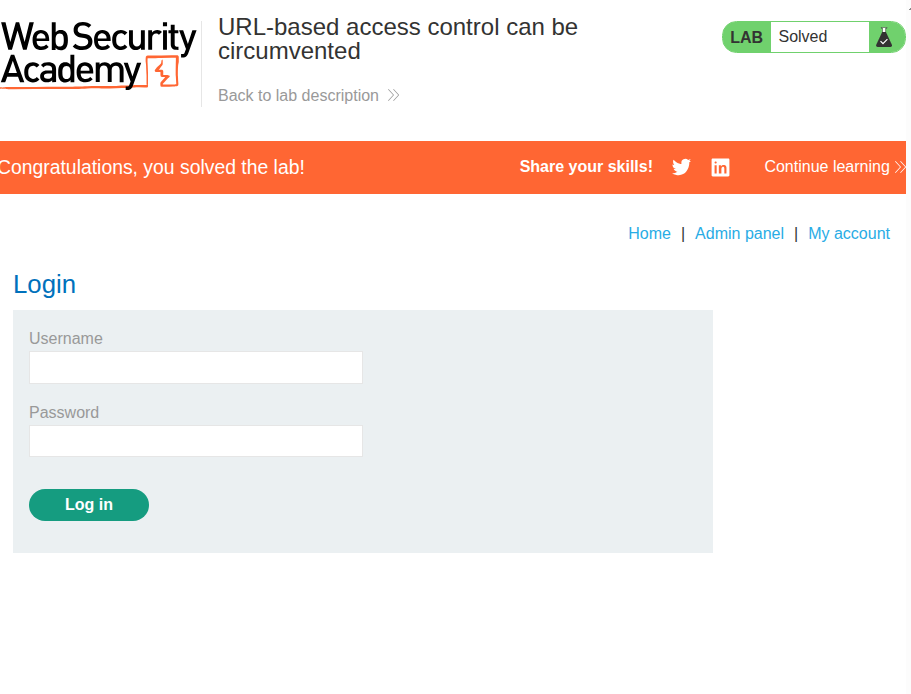

### Description
Simple lab that involves exploiting an unprotected admin panel to delete the user `carlos`.

This time, the path is revealed to be `/admin`, but the front-end strictly denies unauthenticated users from accessing it.
It is stated that the back-end server supports the `X-Original-URL` header.

### Solution
Since I know that the back-end server supports the `X-Original-URL` header, I simply used Burp Repeater to send a request to `/`, which is the home page of the lab. I then appended the following header:

> ```html
> ...
> X-Original-Url: /admin
> ```

The server then returned the admin page! I found the following `div` in the page:

> ```html
> <div>
>      <span>carlos - </span>
>      <a href="/admin/delete?username=carlos">Delete</a>
> </div
> ```

I took the URI here and used it in the header as follows:

> ```html
> ...
> X-Original-Url: /admin/delete
> ```

Since the parameters won't work in the header, I moved them to the request line:

> ```html
> GET /?username=carlos
> ...
> ```

The server returned with the following:

> ```html
> HTTP/2 302 Found
> Location: /admin
> X-Frame-Options: SAMEORIGIN
> Content-Length: 0
> ```

Which means `carlos` was successfully deleted!

---

## 6. Method-based access control can be circumvented
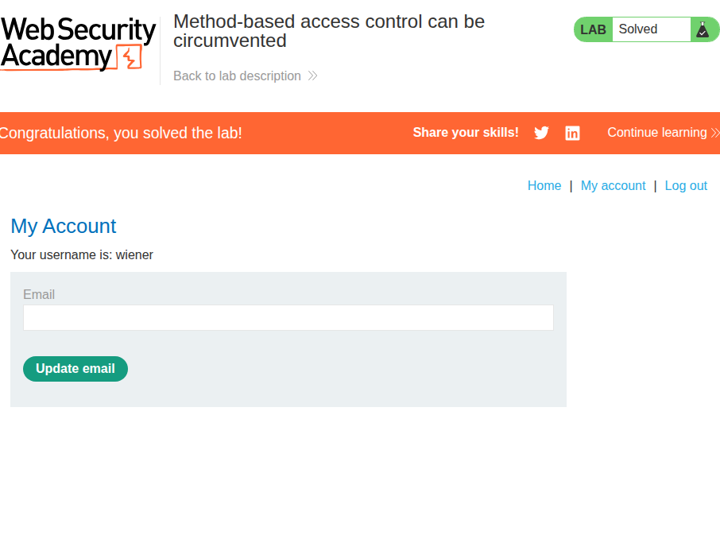

### Description
Simple lab that involves exploiting an unprotected admin panel to promote the user `wiener` to administrator status.

This time, the path is revealed to be `/admin`, but the server explicitly checks for authorization for certain request methods made to the admin endpoint.

The lab supplies an extra set of credentials for an admin user for us to familiarize ourselves with the admin panel: `administrator:admin`.

### Solution
I thought it was strange that we were given admin credentials straight away, but I assumed that it was an way of simulating "exposed" admin endpoints. I logged on to the admin account and was presented with a panel to upgrade and downgrade users:

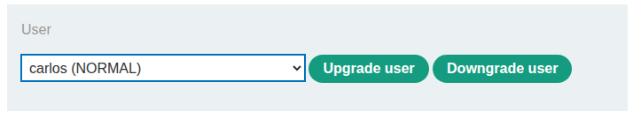

I upgraded and downgraded `carlos` and checked Repeater for the request. It turns out that it was being made to `/admin-roles`. Naturally, I tried to send this request using the normal user `wiener:peter`'s cookie, and was met with the following response:

> ```html
> HTTP/2 401 Unauthorized
> Content-Type: application/json; charset=utf-8
> X-Frame-Options: SAMEORIGIN
> Content-Length: 14
> 
> "Unauthorized"
> ```

Since the lab states explicitly that the server uses HTTP methods as a way to enforce access control, I simply changed the request line to the following:

> `TEST /admin-roles HTTP/2`

Immediately, I got the following response:

> ```html
> HTTP/2 400 Bad Request
> Content-Type: application/json; charset=utf-8
> X-Frame-Options: SAMEORIGIN
> Content-Length: 30
> 
> "Missing parameter 'username'"
> ```

This means that despite the parameters in the request body not being read, the request was actually getting past authorization!

I simply changed the request to the following:

> `TEST /admin-roles?username=wiener&action=upgrade HTTP/2`

Which was basically a copy-paste of the body parameters onto the URL. With this, the server returned the following:

> ```html
> HTTP/2 302 Found
> Location: /admin
> X-Frame-Options: SAMEORIGIN
> Content-Length: 0
> ```

I checked back on the web interface, and the admin panel was now available to me while I was logged in to `wiener:peter`!

---

## 7. User ID controlled by request parameter
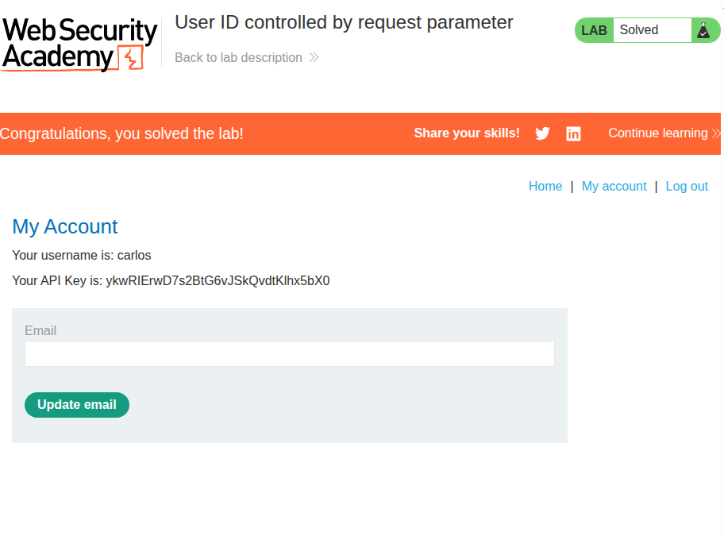

### Description
Lab that involves stealing the API key of user `carlos`.

### Solution
The solution was rather simple. First, I logged on to `wiener:peter` and checked the URL:

> `.../my-account?id=wiener`

I simply changed `id=wiener` to `id=carlos`, and I was presented with the page in the image above. I quickly submitted the API key and the lab was finished!

---

## 8. User ID controlled by request parameter, with unpredictable user IDs
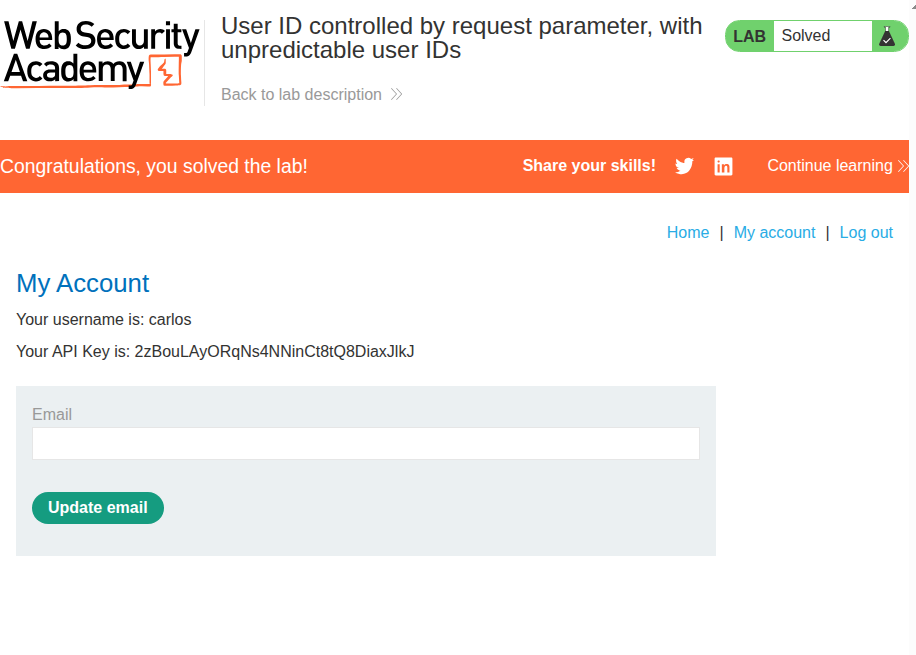

### Description
Lab that involves stealing the API key of user `carlos`. \
This time, `carlos` is assigned an unpredictable GUID.

### Solution
I first logged on to `wiener:peter`. I had to find an unpredictable GUID, so it's probably going to be in some sort of profile page view. The lab application was a blog/forum-like website, so I just dug through the posts until I found this:

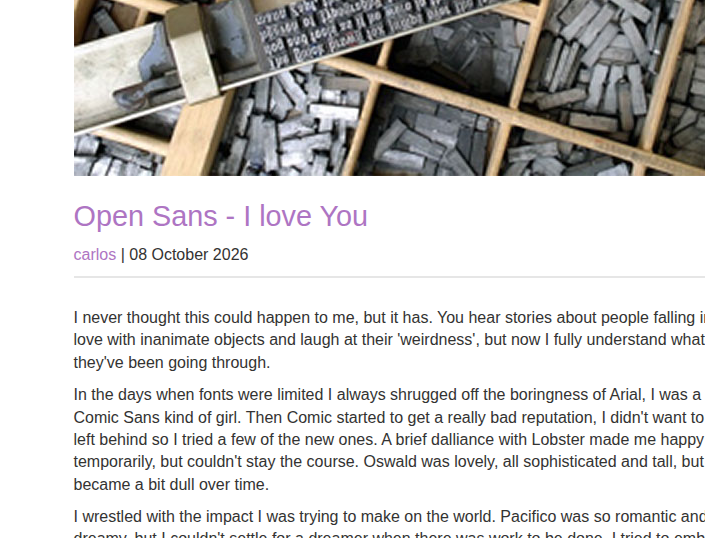

And as expected, upon clicking `carlos`, I was led to a list of all his blog posts. Unsurprisingly, the URL included his GUID as a parameter:

> `67c8dfc9-dd21-44c9-aec5-9e450525246c`

So, I simply changed the URL parameter on my own account to the following:

> `my-account?id=67c8dfc9-dd21-44c9-aec5-9e450525246c`

Which led me to the account page belonging to `carlos`, revealing his API key, as shown in the image above.

---

## 9. User ID controlled by request parameter, with unpredictable user IDs
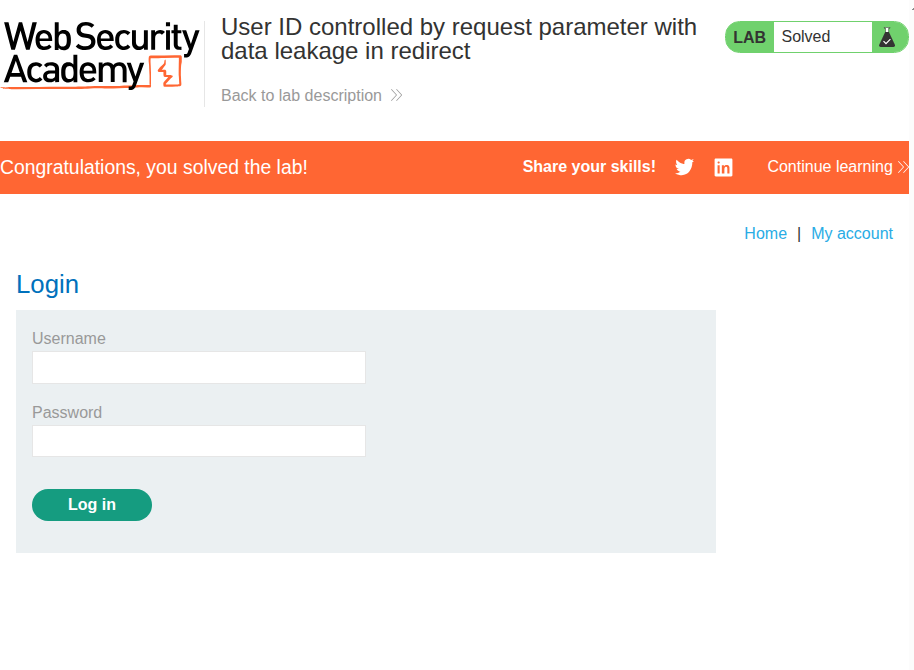

### Description
Lab that involves stealing the API key of user `carlos`. \
This time, the server leaks information in a redirect response.

### Solution
First, I noticed that the `id` URL parameter is back. So naturally, after logging in, I tried changing it to `id=carlos`, but I was just redirected to the login page instead of being led to the page belonging to `carlos`.

However, since the data was supposed to leak in the redirect response, I tried to submit the same GET request again but through Burp Repeater, changing `id` to `id=carlos`. This time, Proxy captured the 302 response:

> ```html
> HTTP/2 302 Found
> Location: /login
> Content-Type: text/html; charset=utf-8
> Cache-Control: no-cache
> X-Frame-Options: SAMEORIGIN
> Content-Length: 3759
> ```

It looks just as expected. However, upon inspection this response actually contains an HTML body that appears to be the account page belonging to `carlos`!

> ```html
> ...
>     <p>
>         Your username is: carlos
>     </p>
>     <div>
>         Your API Key is: QNKWn4tr6TWYNJZ3PzDqJ7XrpVRZKgtH
>     </div>
> ...
> ```

This would not work on the browser as it would likely just automatically redirect the client to `/login` as specified in the `Location` header. DevTools also would likely omit the response body of the redirect. However, Burp Proxy captures intermediary responses, so it was possible to inspect using Burp.

I simply submitted the visible API key and completed the lab.

---

## 10. User ID controlled by request parameter, with unpredictable user IDs
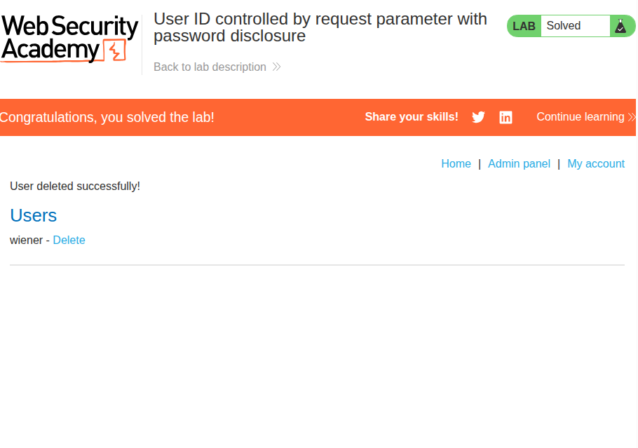

### Description
Lab that involves deleting the user `carlos`. \
This time, the server has a password disclosure vulnerability.

### Solution
In the My Account page, I noticed that there was now a password field that's pre-filled with what's presumably my password. Naturally, I tried to set the `id` paremeter to `id=administrator` to try and see if I could gain access to the administrator's page. However, it simply redirects me to the login page.

However, trying the same trick from [9](#9-user-id-controlled-by-request-parameter-with-unpredictable-user-ids) shows me that the redirect actually still leaks the account page of the user I input. I was able to get into the administrator's account page.

What's even worse is that the HTML body actually **leaks** the pre-filled password in plaintext!

> ```html
> <input required type=password name=password value='a66gcn0w3k1qn7d4v9gv'/>
> <button class='button' type='submit'> Update password </button>
> ```

From here, all I had to do was take the password and log in to `administrator:a66gcn0w3k1qn7d4v9gv`, where I was able to access the admin panel and delete `carlos`.

---

## 11. Insecure direct object references
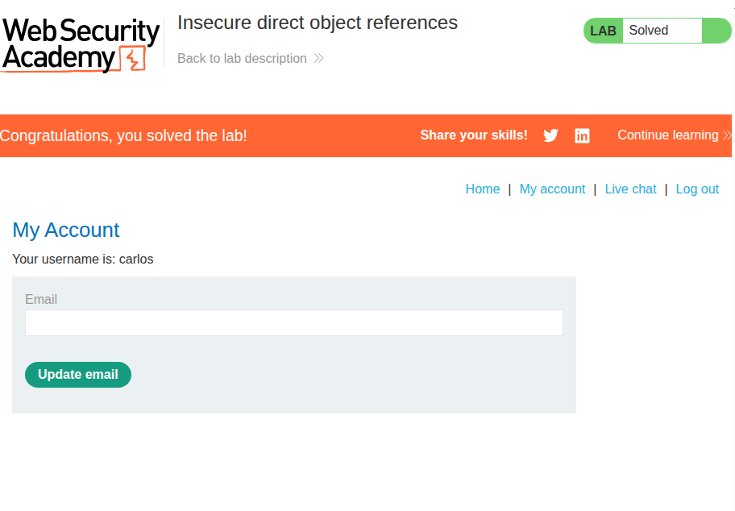

### Description
Lab that involves logging into the user `carlos`. \
This time, the server has an IDOR (insecure direct object refernce) vulnerability.

### Solution
I first checked out the live chat functionality. I tried sending a few messages (which some kind of bot was responding to, suprisingly) and downloading the transcript. It turns out it downloads a text file with a number as its filename. As I downloaded more, it seems to just simply increment the name by one every time.

I noticed that the first file was `2.txt`, meaning there must have been a `1.txt`. I used Burp Repeater to change the request URL to `/download-transcript/1.txt` and sent the request, to which I received the following response:

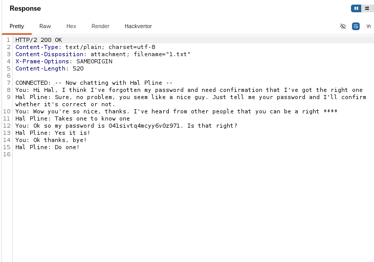

In this chat, it seems like "You" was talking to someone about confirming their own password. They then proceeded to type it into the chat! I didn't know who this user was, but I simply guessed that it was `carlos` and tried the password, which worked.

---

## 12. Multi-step process with no access control on one step
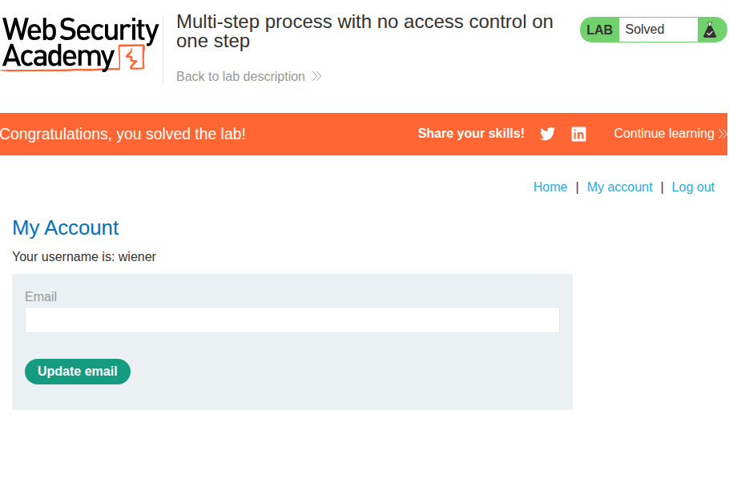

### Description
Lab that involves promoting the user `wiener` to administrator. \
This time, the server has an access control vulnerability in a multi-step process.

The lab supplies details to the `administrator` account to expose the admin processes.

### Solution
First, I checked out the administrator account to see what steps are taken to promote a user to administrator. I tried promoting the user `carlos` and was met with the following:

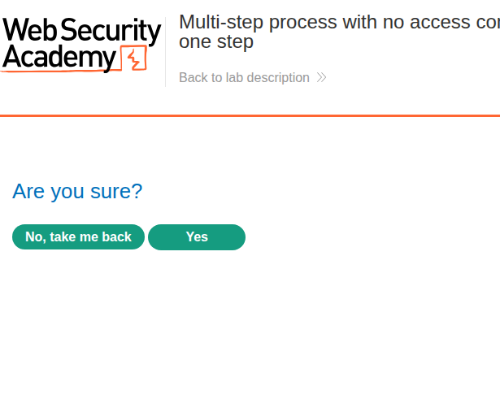

I pressed yes, and promoted `carlos` to an administrator. I quickly checked Burp Proxy to see what requests were made, and it turns out they were two requests with the same method sent to the same URI path. However, the request body differed:

> ```html
> // First POST
> username=carlos&action=upgrade
> 
> // Confirmation POST
> username=carlos&confirmed=true&action=upgrade
> ```

So, I logged off from the administrator account and logged on to `wiener:peter`. I changed the username in the parameters to `wiener`, then used the account's session cookie to send the confirmation `POST` request, and voila:

> ```html
> HTTP/2 302 Found
> Location: /admin
> X-Frame-Options: SAMEORIGIN
> Content-Length: 0
> ```

When I refreshed the page, I suddenly had access to the admin panel, and the lab was solved.

---

## 13. Multi-step process with no access control on one step
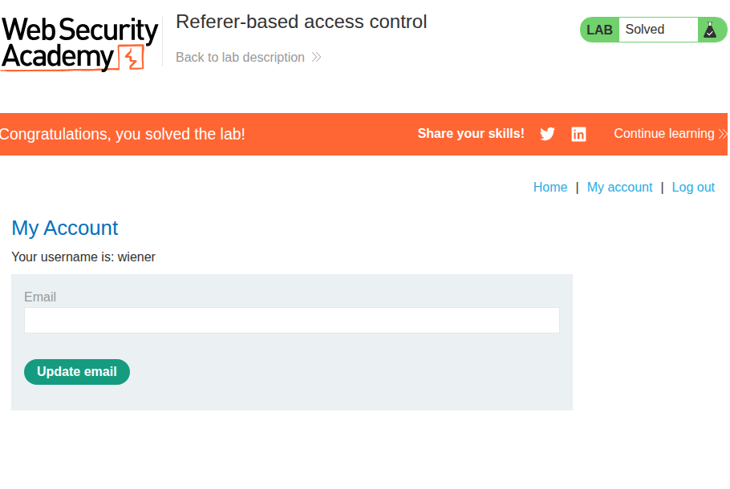

### Description
Lab that involves promoting the user `wiener` to administrator. \
This time, the server has sub-pages that enforce access control by ensuring that the referer is `/admin`.

The lab supplies details to the `administrator` account to expose the admin processes.

### Solution
This lab was surprisingly simple. First, I logged on to the administrator account to trigger the request that promotes another user to administrator.

Then, I inspected it on Burp Proxy and sent it to Repeater. I logged out of the administrator account, logged into `wiener:peter`, and copied its cookie onto the request on Repeater.

Since the `Referer` header still contains `/admin` from the previous administrator request, I didn't have to change anything here. I simply changed the `username` parameter to `wiener` and sent the request with the user-level cookie.

I received a `302 Found` and when I refreshed the page I was an administrator on `wiener:peter`.