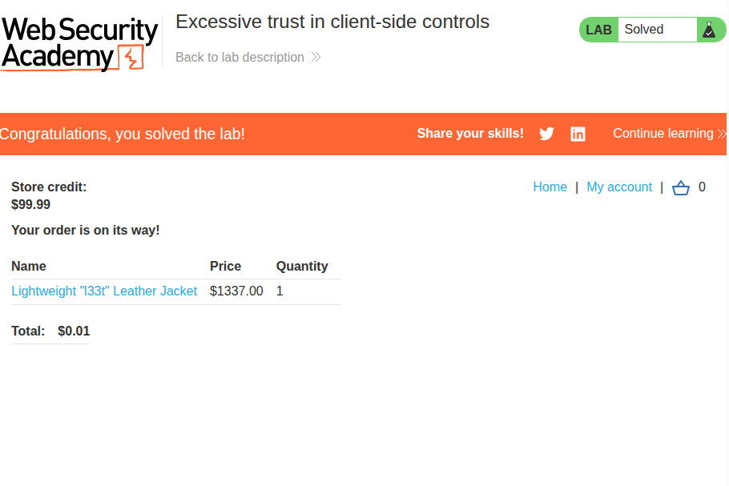
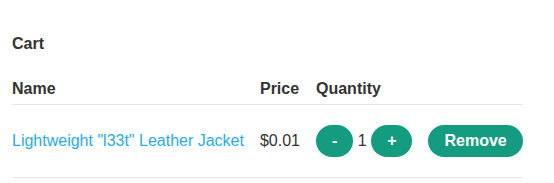
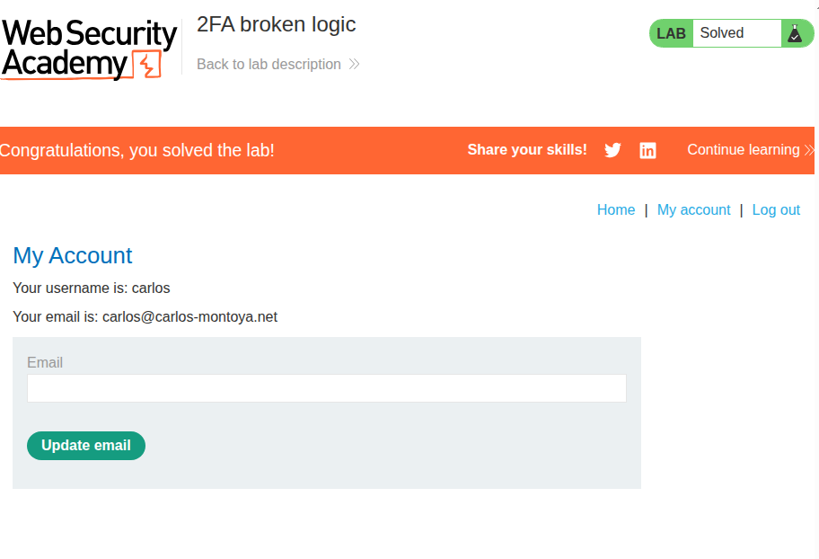
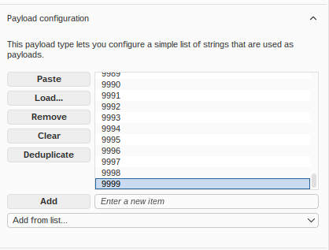
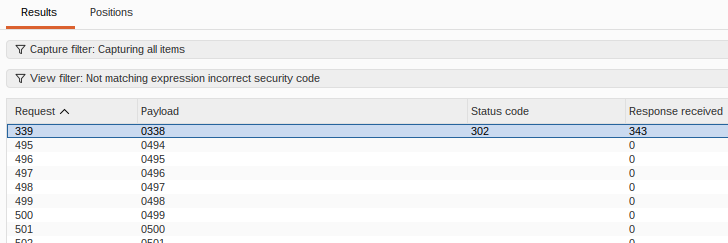
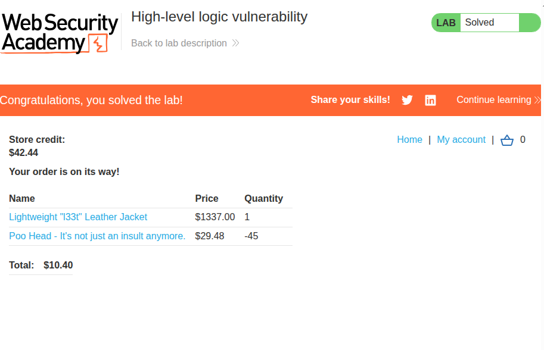
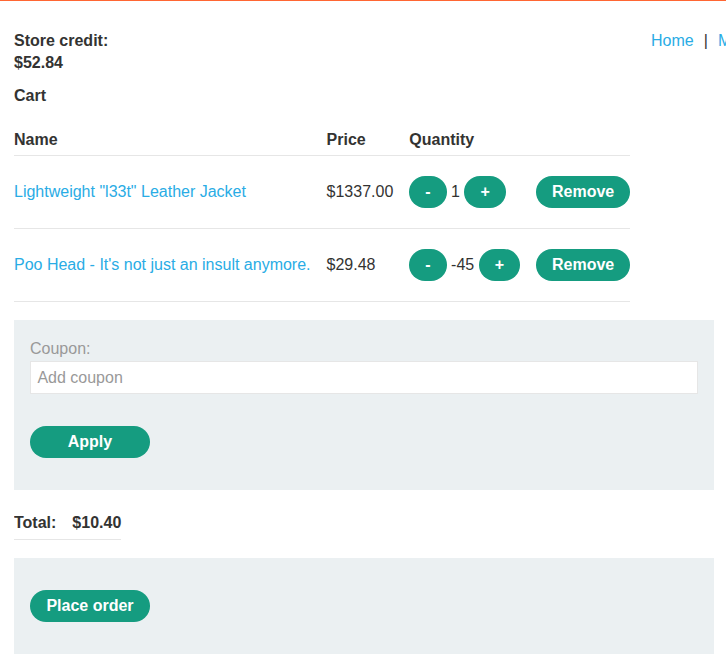
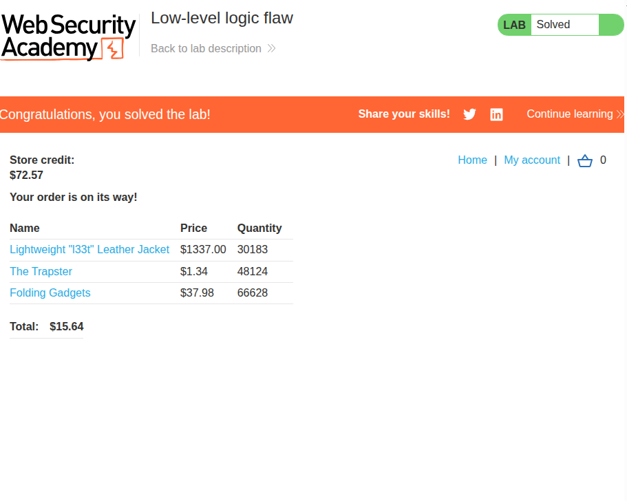
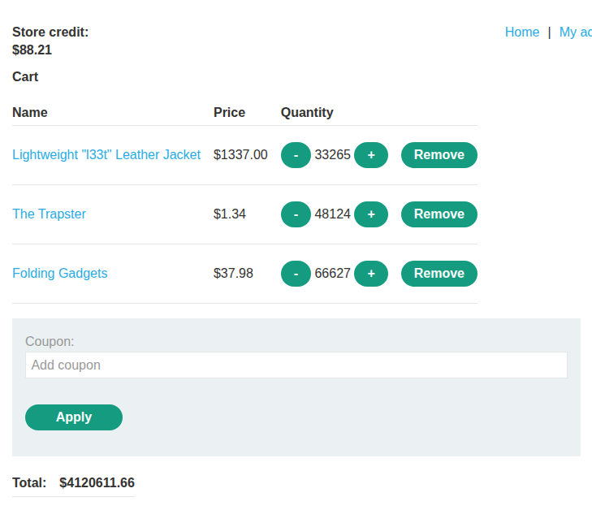
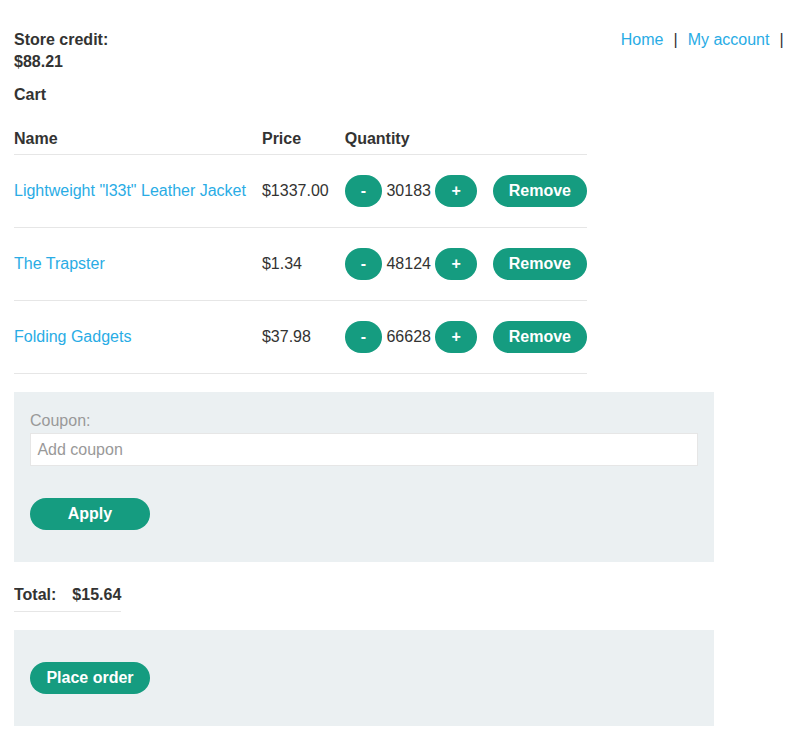

# Business logic vulnerabilities
## 1. Excessive trust in client-side controls


### Description
This lab involves buying a pricey item for a much lower price through request interception.

### Solution
This lab was rather simple: I simply intercepted the request to buy the expensive jacket and changed the request parameters as follows:

> ```
> productId=1&redir=PRODUCT&quantity=1&price=133700
> >
> productId=1&redir=PRODUCT&quantity=1&price=1
> ```

This led to the item being added to my cart with the following ridiculously low price:



I pressed `order` and purchased the item, which completed the lab.

---

## 2. 2FA broken logic


### Description
This lab involves logging into the account `carlos` by exploiting a logic flaw in the app's 2FA implementation.

### Solution
At first, I intercepted packets from the two-step login. I noticed that it had the cookie `verify=[username]`, so I tried putting in `carlos` both times at first. However, this wouldn't let me log in as it would just throw me back onto the login page if I tried using in details belonging to `wiener`.

And then it hit me that I had been trying this for many times, yet there hasn't been any sort of rate-limiting mechanism. So, I decided to send the 2FA request to Repeater and brute-force the 4-digit 2FA code.

First, I used the following command to generate numbers from 0000 to 9999:
> ```sh
> seq -w 0000 9999 > 10k-pad
> ```

Then, I loaded it onto Intruder:



I launched the attack, and then filtered the requests using a negative-search for `Incorrect security code` in the HTML body, since that was the common error message. I saw the following request:



It was a `302`, which is an indication of a successful login. I loaded the response in my browser, and I was on the account page for `carlos`. With this, the lab was complete.

---

## 3. High-level logic vulnerability


### Description
This lab involves purchasing an expensive item for less than what it should cost by exploiting a high-level logic flaw.

### Solution
First, I noticed that when I added an item to cart, there are three parameters being sent:
> `productId=1&redir=PRODUCT&quantity=1`

Immediately, I tried adding a negative quantity of an item. As it turns out, it worked! I'll have negative quantity, but the price will be negative too. So, I tried adding the expensive item, and a very low negative number for some other cheap item together in my cart:



Now, the total is well within my lab-given store credit budget. I pressed order, and the lab completed itself!

---

## 4. Low-level logic vulnerability


### Description
This lab involves purchasing an expensive item for less than what it should cost by exploiting a low-level logic flaw.

### Solution
At first, I tried the same trick as [3](#3-high-level-logic-vulnerability). Unsurprisingly, it didn't work. This time, the application limited the quantity of an item to 0.

However, I thought that this trick could work if I could make the price field overflow, assuming it's using some primitive data type to hold the price value in the back-end. So, I tried adding 999999 of the expensive item:

> `productId=1&redir=PRODUCT&quantity=999999`

Unfortunately, this was met with the following response:

> ```
> HTTP/2 400 Bad Request
> Content-Type: application/json; charset=utf-8
> X-Frame-Options: SAMEORIGIN
> Content-Length: 29
> 
> "Invalid parameter: quantity"
> ```

I tried smaller and smaller numbers, which eventually worked for `99`. This probably meant that I could only input `99` as the maximum quantity to add at a time. This wasn't a problem, as I just used Burp Intruder with a null payload to indefinitely send requests until it got to a negative value:



In this case, I let it overflow too much and it wrapped around to some large value. All I had to do was do the trick I did in [3](#3-high-level-logic-vulnerability) to reduce the price from this to below \$100 and above \$-1. I adjusted it with some other items too:



With that, I was able to purchase the item and complete the lab!