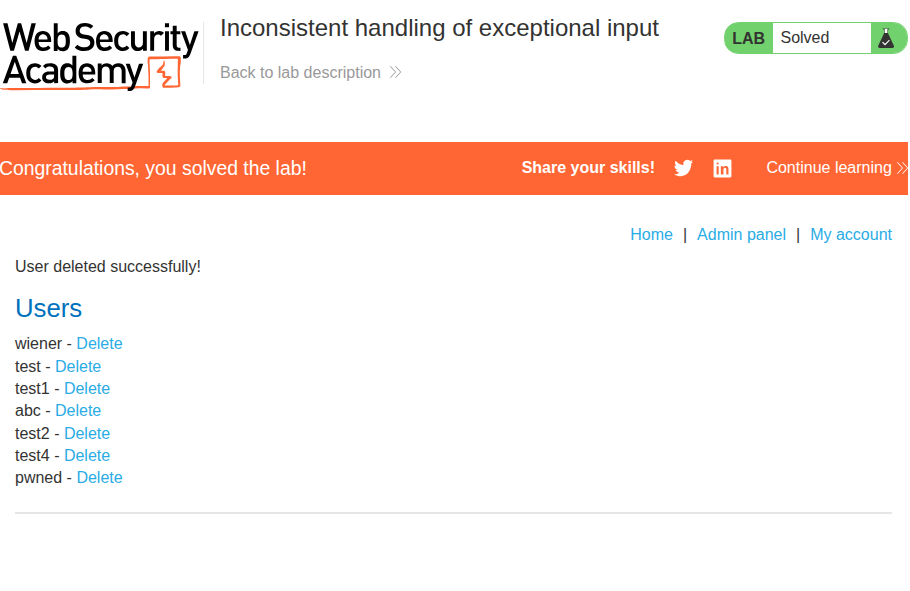
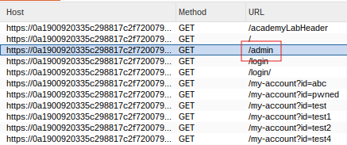
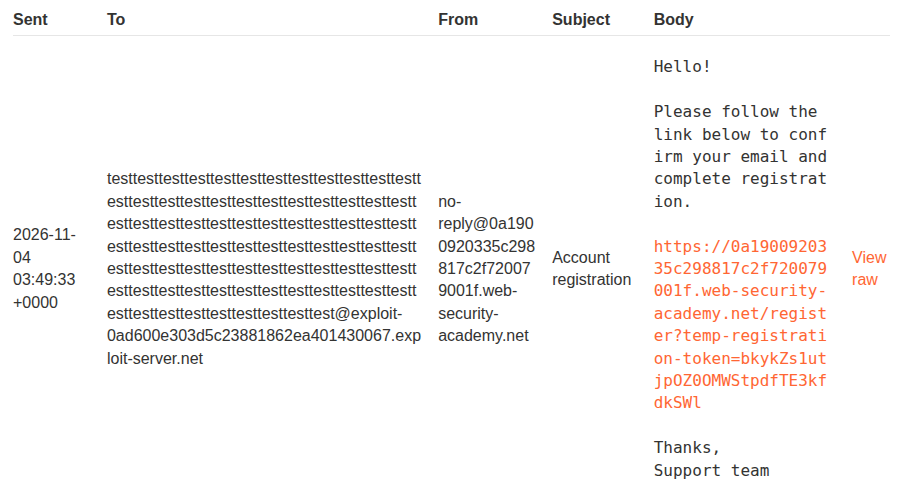
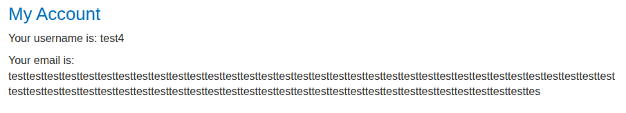
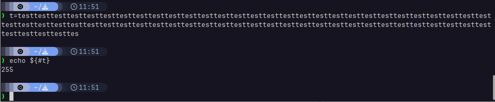
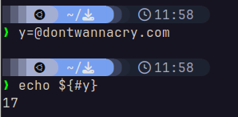
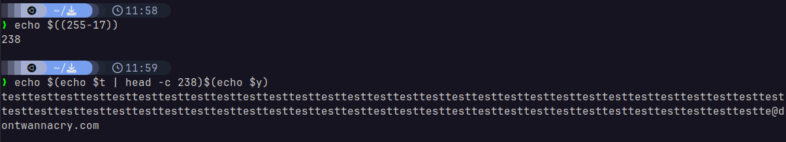
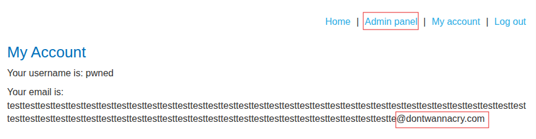

# Business logic vulnerabilities
## 1. Excessive trust in client-side controls


### Description
This lab involves buying a pricey item for a much lower price through request interception.

### Solution
This lab was rather simple: I simply intercepted the request to buy the expensive jacket and changed the request parameters as follows:

> ```
> productId=1&redir=PRODUCT&quantity=1&price=133700
> >
> productId=1&redir=PRODUCT&quantity=1&price=1
> ```

This led to the item being added to my cart with the following ridiculously low price:


I pressed `order` and purchased the item, which completed the lab.

---

## 2. 2FA broken logic


### Description
This lab involves logging into the account `carlos` by exploiting a logic flaw in the app's 2FA implementation.

### Solution
At first, I intercepted packets from the two-step login. I noticed that it had the cookie `verify=[username]`, so I tried putting in `carlos` both times at first. However, this wouldn't let me log in as it would just throw me back onto the login page if I tried using in details belonging to `wiener`.

And then it hit me that I had been trying this for many times, yet there hasn't been any sort of rate-limiting mechanism. So, I decided to send the 2FA request to Repeater and brute-force the 4-digit 2FA code.

First, I used the following command to generate numbers from 0000 to 9999:
> ```sh
> seq -w 0000 9999 > 10k-pad
> ```

Then, I loaded it onto Intruder:


I launched the attack, and then filtered the requests using a negative-search for `Incorrect security code` in the HTML body, since that was the common error message. I saw the following request:


It was a `302`, which is an indication of a successful login. I loaded the response in my browser, and I was on the account page for `carlos`. With this, the lab was complete.

---

## 3. High-level logic vulnerability


### Description
This lab involves purchasing an expensive item for less than what it should cost by exploiting a high-level logic flaw.

### Solution
First, I noticed that when I added an item to cart, there are three parameters being sent:
> `productId=1&redir=PRODUCT&quantity=1`

Immediately, I tried adding a negative quantity of an item. As it turns out, it worked! I'll have negative quantity, but the price will be negative too. So, I tried adding the expensive item, and a very low negative number for some other cheap item together in my cart:


Now, the total is well within my lab-given store credit budget. I pressed order, and the lab completed itself!

---

## 4. Low-level logic vulnerability


### Description
This lab involves purchasing an expensive item for less than what it should cost by exploiting a low-level logic flaw.

### Solution
At first, I tried the same trick as [3](#3-high-level-logic-vulnerability). Unsurprisingly, it didn't work. This time, the application limited the quantity of an item to 0.

However, I thought that this trick could work if I could make the price field overflow, assuming it's using some primitive data type to hold the price value in the back-end. So, I tried adding 999999 of the expensive item:

> `productId=1&redir=PRODUCT&quantity=999999`

Unfortunately, this was met with the following response:

> ```
> HTTP/2 400 Bad Request
> Content-Type: application/json; charset=utf-8
> X-Frame-Options: SAMEORIGIN
> Content-Length: 29
> 
> "Invalid parameter: quantity"
> ```

I tried smaller and smaller numbers, which eventually worked for `99`. This probably meant that I could only input `99` as the maximum quantity to add at a time. This wasn't a problem, as I just used Burp Intruder with a null payload to indefinitely send requests until it got to a negative value:


In this case, I let it overflow too much and it wrapped around to some large value. All I had to do was do the trick I did in [3](#3-high-level-logic-vulnerability) to reduce the price from this to below \$100 and above \$-1. I adjusted it with some other items too:


With that, I was able to purchase the item and complete the lab!

---

## 5. Inconsistent handling of exceptional input


## Description
This lab involves exploiting a flaw in the registration system to gain administrator access on the server.

## Solution
This lab was quite tricky. I first played around with the registration system, signing up on a few accounts to see if I could somehow trick the system into thinking that I had just created an admin account.

However, this bore little fruit. So, I tried to crawl the URI paths of the server using Burp Target. I saw the following interesting URI path (yes, I started using the red squares):



Looks like Target had just found the `/admin` path. I tried accessing it, but it returned with the following message:

> `Admin interface only available if logged in as a DontWannaCry user`

I did notice that the registration page had the following notification too:

> `If you work for DontWannaCry, please use your @dontwannacry.com email address`

I had the idea to trick the system into thinking that I was using that domain. I was given access to a custom email server by the lab, which came with the following domain:

> `@exploit-0ad600e303d5c23881862ea401430067.exploit-server.net`

Which means I could technically attach `dontwannacry.com` to it as follows:

> `@dontwannacry.com.exploit-0ad600e303d5c23881862ea401430067.exploit-server.net`

The above works perfectly fine, as there is no rule saying you can't use `.com` as a subdomain name. The email domain will route every email bound for every subdomain to the email server (as stated).

Since this lab was supposed to have a bug, I checked if the email had a maximum character limit:



To my surprise, it didn't. Not only that, it seems that after I logged into the account, the end of the email was truncated (presumably because it was too long):



This made things trivial! All I had to do was attach `dontwannacry.com` as a subdomain to the exploit email domain, then make the email username long enough to make it truncate the rest of the email. The idea is that registration email may still be sent to the exploit email, but the server would check only the truncated portion!

First, I checked the length of the truncated portion:



Then, I checked the length of the domain I needed to attach:



With that information, I crafted an exploit email:



I signed up with the following email and checked my profile:
> ```
> testtesttesttesttesttesttesttesttesttesttesttesttesttesttesttesttesttesttesttesttesttesttesttesttesttesttesttesttesttesttesttesttesttesttesttesttesttesttesttesttesttesttesttesttesttesttesttesttesttesttesttesttesttesttesttesttesttesttestte@dontwannacry.com.exploit-0ad600e303d5c23881862ea401430067.exploit-server.net
> ```



Success! Looks like it truncated exactly where the `dontwannacry.com` domain ended, which seems to have tricked the server into thinking that this was a genuine email of that domain.

With that, I opened the administrator panel and deleted `carlos`. 