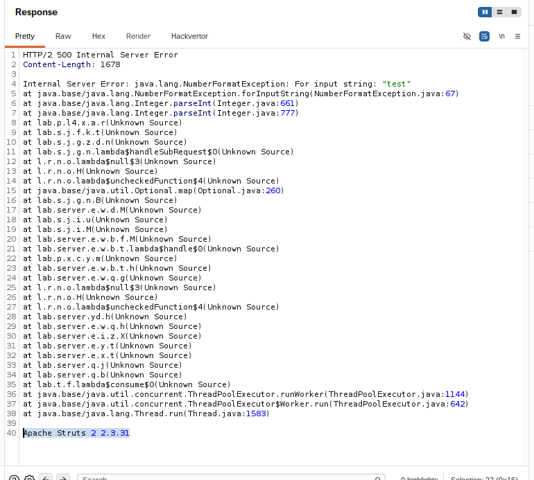
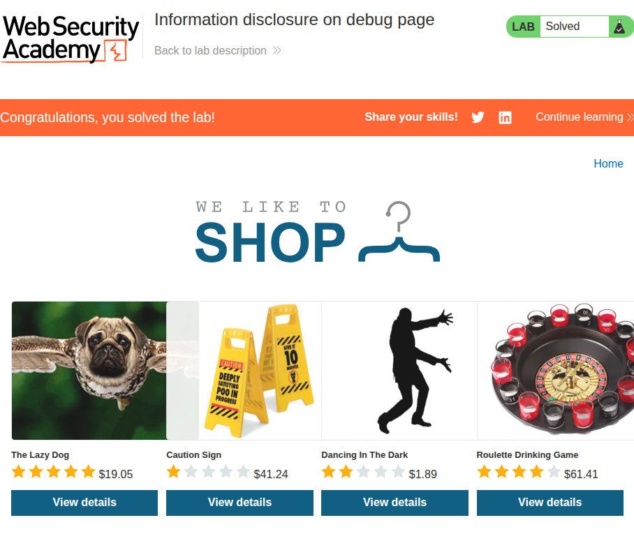
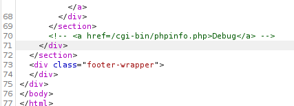
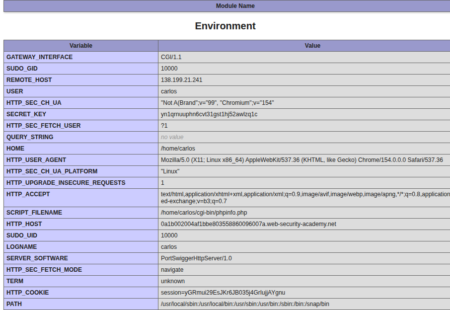
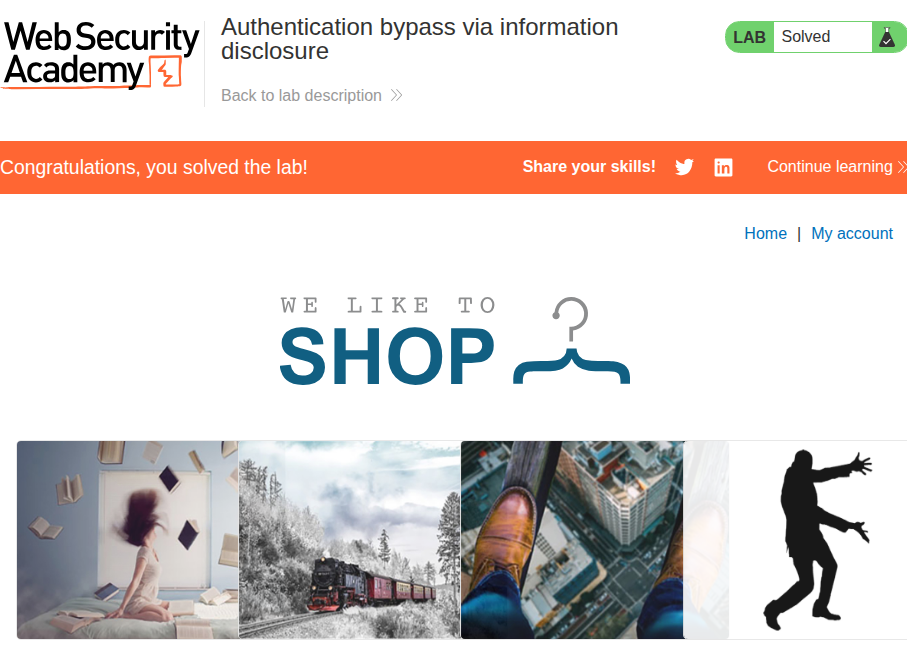
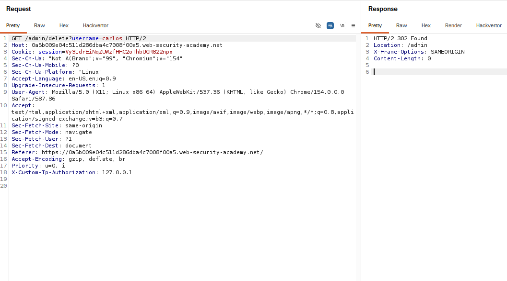
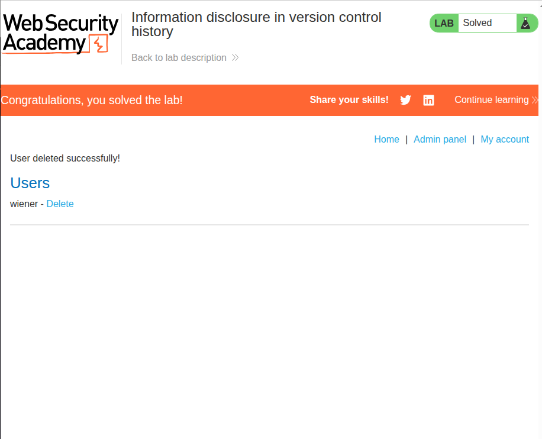
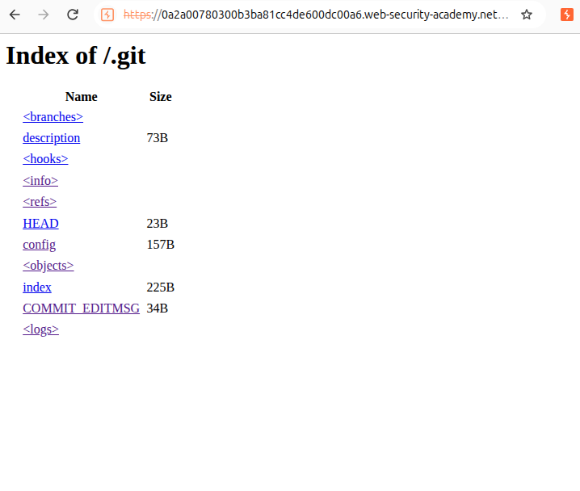
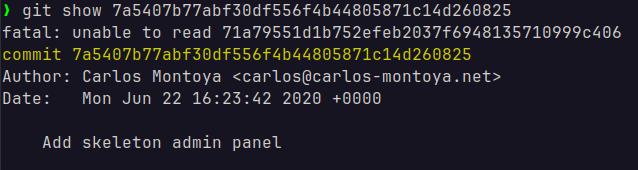
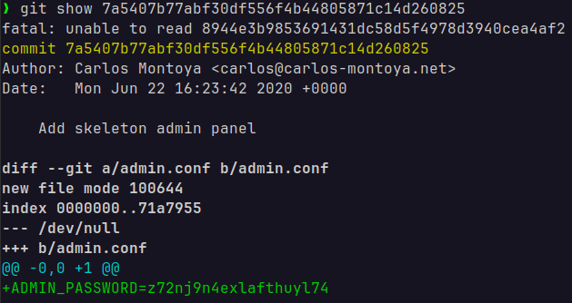

# Information Disclosure
## 1. Information disclosure in error messages


### Description
Simple lab that involves getting the version of the site's third-party framework through verbose errors.

### Solution
I noticed that the site had nothing in it except the catalogue of items that I could view. This sends a `GET` request, so I tried getting an error message by changing the integer parameter of `productId` to `productId=test`. Immediately, I get the following `500 Internal Server Error` response:



It can be seen at the bottom that the framework being used is `Apache Struts 2 2.3.31`. This was submitted and the lab was complete.

---

## 2. Information disclosure on debug page


### Description
Simple lab that involves finding a debug page and submitting the `SECRET_KEY` environment variable.

### Solution
Like in [1](#1-information-disclosure-in-error-messages), the lab only had the product catalogue, so I clicked on one and inspected the HTML body through Burp Proxy. Very quickly I notice the following near the footer:



Upon visiting that URI path, I was met with a `phpinfo` page, which contained every single configuration variable, including `SECRET_KEY`:



The secret key is `yn1qrnuuphn6cvt31gst1hj52awlzq1c`, and submitting it completed the lab.

---

## 3. Source code disclosure via backup files


### Description
Simple lab that involves finding the backup file of part of the source code and stealing a hardcoded database password.

### Solution
I clicked around but this time I couldn't find anything. So, I tried visiting `/sitemap.xml` and `/robots.txt`. Thankfully, the latter gave me the following:

> ```html
> HTTP/2 200 OK
> Content-Type: text/plain; charset=utf-8
> X-Frame-Options: SAMEORIGIN
> Content-Length: 32
> 
> User-agent: *
> Disallow: /backup
> ```

So, I visited `/backup`, which led me to a page with the following HTML fragment:

> ```html
> <td>
>     <a href='/backup/ProductTemplate.java.bak'>
>         ProductTemplate.java.bak
>     </a>
> </td>
> ```

This is obviously a Java backup file, so I followed the path and found the following Java code fragment:

> ```java
> ConnectionBuilder connectionBuilder = ConnectionBuilder.from(
>     "org.postgresql.Driver",
>     "postgresql",
>     "localhost",
>     5432,
>     "postgres",
>     "postgres",
>     "ivdmih55ki4eaf37pfyvd3sq3dtg3dl2"
> ).withAutoCom();
> ```

This is the instantiation of what seems to be an SQL driver object in Java. However, instead of pulling from a file or some other secret manager, this implementation seems to have hardcoded it in the function.

I submitted `ivdmih55ki4eaf37pfyvd3sq3dtg3dl2` as the password and completed the lab.

---

## 4. Authentication bypass via information disclosure


### Description
Simple lab that involves finding a custom header to bypass authentication and using the administrator panel to delete the user `carlos`.

### Solution
I tried a multitude of headers on `/` using Burp Intruder, but only two returned a 200: `GET` and `TRACE`. I know what `GET` was going to give me, so I checked the response body for `TRACE`:

> ```
> ...
> X-Custom-IP-Authorization: [REDACTED]
> ```

It looks like it leaked out a custom header, which could be used to check if this IP should be authorized. Since this was my actual IP address, I redacted it from the example. I took this header and changed it to `127.0.0.1`, which would theoretically trick the server that I was on its network.

After checking the response body, I found that the "admin panel" started showing up, which means I was now authorized despite never having been authenticated. I followed the admin panels until I found the deletion option for `carlos`, and sent the following request:



With the above, the lab was complete as `carlos` was deleted.

---

## 5. Information disclosure in version control history


### Description
This lab involves looking at the application's version control history to find the password to `administrator` and use the account to delete the user `carlos`.

### Solution
This lab was actually more involved. The obvious version control to me was `git`, and so I checked `/.git` to see if it would lead to the raw `.git` file. However, it was an HTML index of the `.git` file instead:



I took this opportunity to look at the commits, in which I saw the following:

> ```
> 0000000000000000000000000000000000000000 7a5407b77abf30df556f4b44805871c14d260825 Carlos Montoya <carlos@carlos-montoya.net> 1793723270 > +0000	commit (initial): Add skeleton admin panel
> 7a5407b77abf30df556f4b44805871c14d260825 680feb043e53c180306d25ca0bbe83cc5addc07f Carlos Montoya <carlos@carlos-montoya.net> 1793723270 > +0000	commit: Remove admin password from config
> ```

Looks like someone had accidentally committed the admin password onto the repository. I kept track of the version hash **before** the change:
> `7a5407b77abf30df556f4b44805871c14d260825`

I constructed my own repository on my local device using the following commands:
> ```sh
> mkdir repo
> cd repo
> git init
> mkdir -p .git/objects/7a
> ```

After that, I downloaded the object file and moved it into `/7a`, naming it the hash name with `7a` removed. Then, I used `git show` to reveal its contents:
> ```sh
> mv 5407b77abf30df556f4b44805871c14d260825 .git/objects/7a
> git show 7a5407b77abf30df556f4b44805871c14d260825
> ```



It looks like I needed more parts of the tree. I downloaded and did the same for two more hashes after that:
> `71a79551d1b752efeb2037f6948135710999c406`
> `56c8c6119717d2c81d181b3e0612b3b1d76cab0c`

And eventually I was able to see the following through `git show`:



Which means the following was the password to `administrator`:
> `z72nj9n4exlafthuyl74`

I used it to log in, deleted `carlos`, and completed the lab.

With that, the Information Disclosure section is finished!
