# Cross-Site Scripting (XSS)
## 1. Reflected XSS into HTML context with nothing encoded
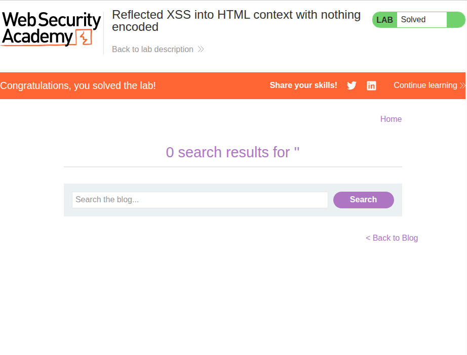

### Description
Simple lab with a site that reflects your XSS payload upon submission. Task is to trigger the `alert()` function through a script payload.

### Solution
I used the following script tag and submitted it through the search bar:
> ```js
> <script>alert("hi!!!")</script>
> ```
Immediately, the following pop-up appeared:

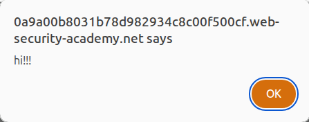

Lab complete.

---

## 2. Stored XSS into HTML context with nothing encoded
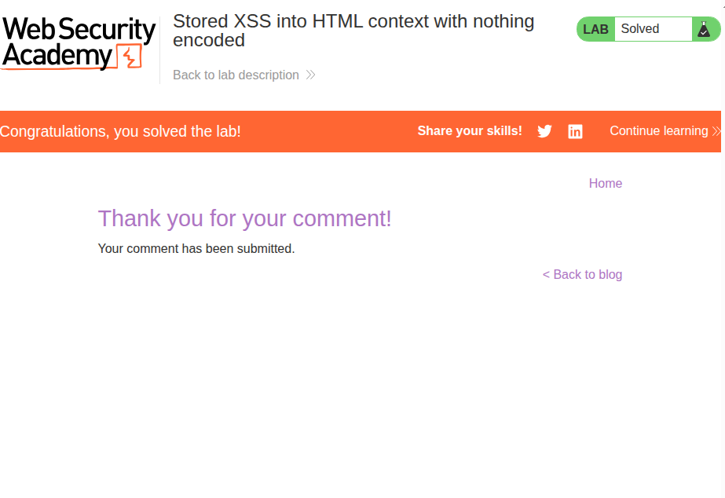

### Description
The lab involves attacking a blog-style website with a comment functionality. The task is to comment something that will trigger the `alert()` function.

### Solution
I simply commented a payload similar to the one I submitted in [1](#1-reflected-xss-into-html-context-with-nothing-encoded):
> ```js
> <script>alert("XD")</script>
> ```
I was then presented with a "lab complete" screen and a back button. Upon hitting the back button, the XSS attack immediately came to life:

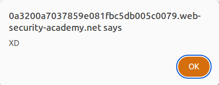

Which really shows me how dangerous this vulnerability could be if left unhandled.

---

## 3. DOM XSS in document.write sink using source location.search


### Description
The same environment as [1](#1-reflected-xss-into-html-context-with-nothing-encoded), which is a site with a search bar and nothing else. This time, the reflected XSS vulnerability does not exist and is replaced with a DOM sink vulnerability related to `location.search` instead.

### Solution
First, I looked for where the DOM sink is, which is related to `location.search` in this case. I used `CTRL+F` to look for `location.search` in the HTML body with DevTools.

Looks like it was writing queries onto an `` tag, which it'll directly write onto the DOM:
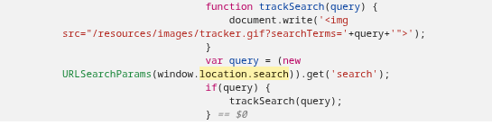
Similar to SQL injection, I quickly crafted a payload:

> `">  ``

The error is guaranteed to trigger as it's set to an invalid image URL. Immediately upon submitting, the pop-up appeared:

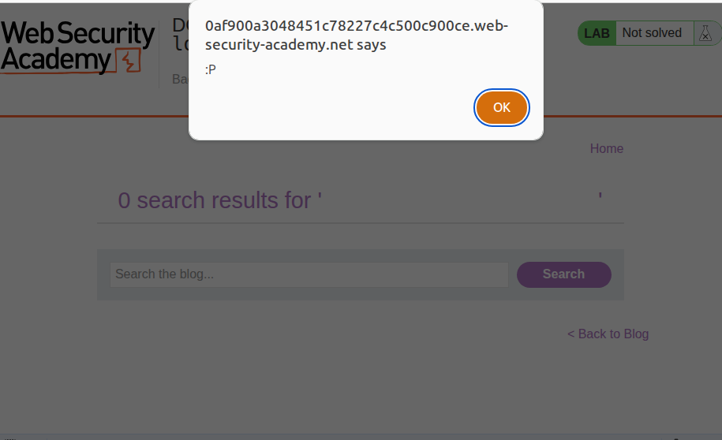

Which means lab complete!

---

## 5. DOM XSS in jQuery anchor href attribute sink using location.search source
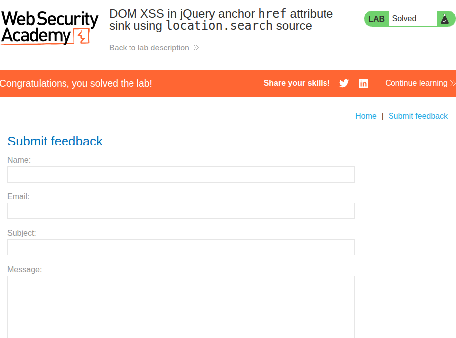

### Description
A more unique lab this time: we are given a back button on a blog-style website. The task is to make it trigger `alert(document.cookie)` on click.

### Solution
As usual, I first looked at the "back" button on DevTools. Tracing its `id=backLink` through `CTRL+F` led me to the following script tag:

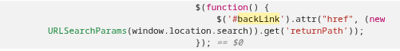

Since the search queries are being injected straight into the `href` attribute of an anchor tag, I could possibly use the `javascript:` pseudo-protocol through the search query. I came up with the following simple payload:
> `javascript:alert(document.cookie)`

I replaced the value of the query parameter `returnPath` in the URL with the above payload, and then refreshed. After the page was refreshed, I clicked the "back" button, and immediately the pop-up appeared:

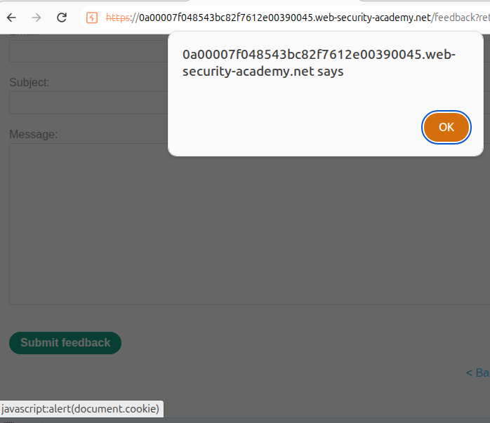

Which means the lab is done!

---

## 6. DOM XSS in jQuery selector sink using a hashchange event
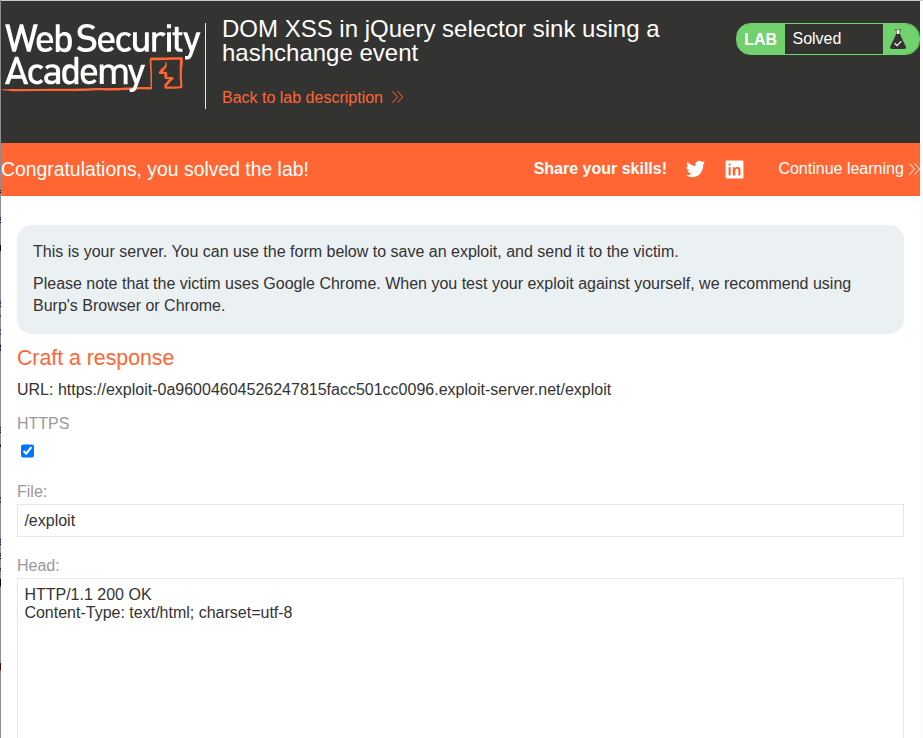

### Description
Interesting lab this time. We have the same blog-style website, but this time the attack vectors introduced in the previous questions were not present. Instead, we are informed that there is an element that uses the `hashchange` event within the page, and are told to use it to trigger the `print()` function.

The twist is that we have to use a lab-provided exploit server to "deliver" our malicious payload to a fictional victim.

### Solution
First, I used DevTools to inspect where `hashchange` was being used:

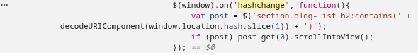

Immediately, I spot the following: 
> `$('section.blog-list h2:contains(' + decodeURIComponent(window.location.hash.slice(1)) + ')')`

The above means that whatever is decoded by `decodeURIComponent` will be evaluated by jQuery. This should include HTML elements with events attached to them. I created the following payload:
> ``

Since this vulnerability involves `hashchange`, technically I could have inserted a blank hash, and then changed it to one with the payload to trigger it on my own browser like so:
> `https://0aef00be03153b2b8002030700760066.web-security-academy.net#`

This would have caused the malicious payload to be evaluated by jQuery, triggering the script on my client. However, the lab wanted me to create my own malicious payload using their exploit server and send it to a fictional victim. This means we can do something much more nefarious with `iframes`:
> `<iframe src="https://0aef00be03153b2b8002030700760066.web-security-academy.net#" onload="this.src+=''"></iframe>`

The above payload is to be sent in an HTTP response to a fictional victim, which will cause the `iframe` to be loaded by their client. However, this highly malicious payload is set to change its own `src` attribute upon loading, which at the same time changes the `hash` of the vulnerable site (the lab). This means the client is stuck in an infinite loop of `print()`s until the victim forces the tab or browser to close.

In any case, I entered the above payload into the exploit server's response body and hit "send," which completed the lab. Since I was on a virtual machine, I also rendered the response on my own browser, which, as expected, caused it to open the "print" prompt infinitely:

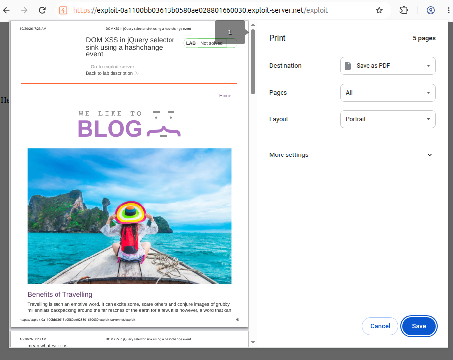

---

## 7. Reflected XSS into attribute with angle brackets HTML-encoded
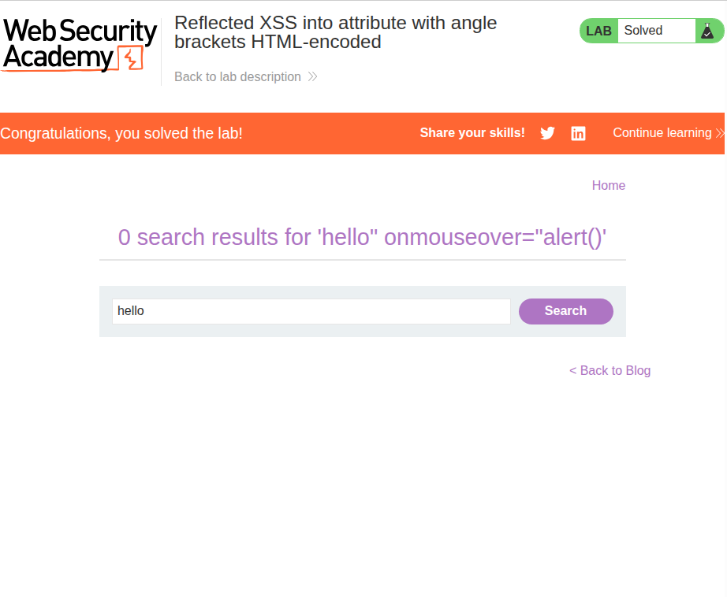

### Description
Back to the setting of [1](#1-reflected-xss-into-html-context-with-nothing-encoded), we are presented with a search bar and nothing else. The goal is to trigger an `alert()` within the browser.

### Solution
First, I typed in "hello" into the search bar and looked for elements that contain it:

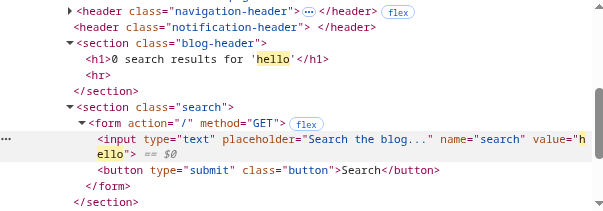

We can see that it gets encoded into the attribute `value` as `value="hello"`. This makes it trivial. I created an injection payload:
> `hello" onmouseover="alert()`

The above is designed to perfectly fit the quotation marks such that the attribute `onmouseover="alert()"` is added onto the HTML element. I entered that into the search bar and the popup appeared as I put my mouse over the element, which completed the lab.